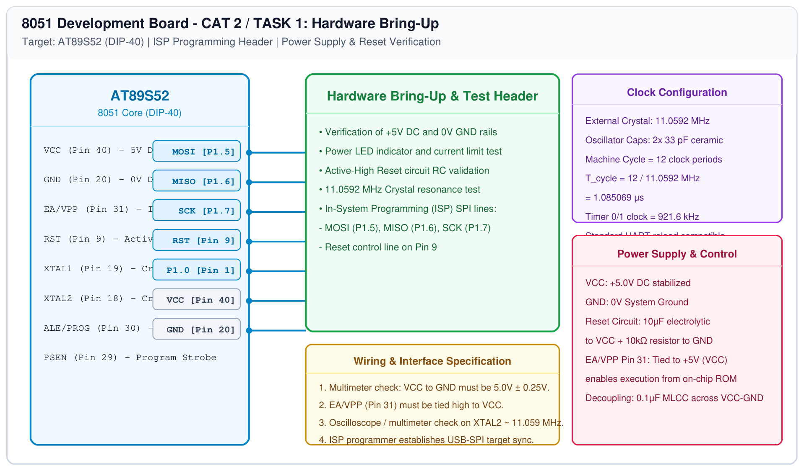

# 8051 Development Board Tool Chain Setup – Hardware Board Bring-Up

## 1. Experiment Details
- **Experiment Identifier:** CONTINUOUS LAB EVALUATION-2 (Week 2)
- **Experiment Name:** 8051 Development Board Tool Chain Setup – Development Board – AT89S52
- **Hardware Platform:** 8051 Microcontroller (AT89S52 DIP-40) + Digital Multimeter (DMM) + USB-ISP Programmer
- **Task Number:** TASK 1 — Hardware Board Bring-Up

---

## 2. Hardware Setup and Components
| Component | Specification / Value | Quantity | Function |
|---|---|---|---|
| Microcontroller IC | AT89S52-24PU (DIP-40) | 1 | 8-bit 8051 MCU, 8KB Flash, 256B RAM |
| Crystal Oscillator | 11.0592 MHz Quartz Crystal | 1 | Primary system clock reference |
| Ceramic Capacitors | 33 pF | 2 | Crystal load oscillation stabilization |
| Electrolytic Capacitor | 10 μF / 25V | 1 | Power-on reset charging network |
| Resistor | 10 kΩ (1/4 W) | 1 | Power-on reset pull-down discharge path |
| Resistor | 330 Ω (1/4 W) | 1 | Power indicator LED current limiter |
| Indicator LED | 3mm Red LED | 1 | Visual confirmation of power rails |
| Digital Multimeter | True RMS DMM | 1 | Rail voltage and continuity verification |
| USB-ISP Programmer | USBASP / USB-ISP 8051 Programmer | 1 | Target flash memory programming |

---

## 3. Circuit Diagram
The circuit diagram below details the bare-metal power-on reset, external crystal clock oscillator network, in-system programming (ISP) lines, and power distribution rails for the AT89S52 microcontroller.

---

## 4. Required Pin Connections
| Pin Number | 8051 Pin Identifier | Subsystem / Net | Connection Target / External Peripheral |
|---|---|---|---|
| Pin 40 | VCC | Power Supply Rail | Regulated +5.0V DC power source |
| Pin 20 | GND | Ground Reference | 0.0V DC common system ground plane |
| Pin 31 | EA / VPP | Memory Access Mode | Tied directly to +5V VCC (External Access disabled, execute from internal 8KB ROM) |
| Pin 9 | RST | Master Reset Input | Junction of 10μF capacitor (to VCC) and 10kΩ resistor (to GND) |
| Pin 19 | XTAL1 | Inverting Osc Input | 11.0592 MHz crystal terminal 1 + 33pF capacitor to GND |
| Pin 18 | XTAL2 | Inverting Osc Output | 11.0592 MHz crystal terminal 2 + 33pF capacitor to GND |
| Pin 1 | P1.0 | General Purpose I/O | User Test Point / LED status node |
| Pin 6 | P1.5 / MOSI | ISP Programming SPI | USB-ISP Programmer Master Out Slave In |
| Pin 7 | P1.6 / MISO | ISP Programming SPI | USB-ISP Programmer Master In Slave Out |
| Pin 8 | P1.7 / SCK | ISP Programming SPI | USB-ISP Programmer Serial Shift Clock |

---

## 5. Clock Configuration
- **Oscillator Type:** External Quartz Crystal
- **Crystal Frequency ($f_{\text{osc}}$):** 11.0592 MHz
- **Load Capacitance ($C_1, C_2$):** 33 pF ceramic capacitors to ground
- **Machine Cycle Structure:** Classic 8051 architecture where 1 Machine Cycle = 12 Oscillator Clock Periods.
- **Machine Cycle Period ($T_{\text{cycle}}$):**
  $$T_{\text{cycle}} = \frac{12}{11.0592 \text{ MHz}} \approx 1.085069 \mu\text{s}$$
- **Instruction Execution Rate:** Approximately 921,600 machine cycles per second.

---

## 6. Pseudocode / Implementation Logic
### Hardware Bring-Up Protocol:
1. **Visual Inspection:** Inspect PCB tracks, orientation notch of the DIP-40 socket (pin 1 marker), solder joints, and ensure no solder bridges exist across adjacent pins.
2. **Cold Multimeter Resistance Check:**
   - Measure resistance between VCC (Pin 40) and GND (Pin 20) with no power applied.
   - Verify reading $> 10\text{ k}\Omega$ to ensure no dead short across supply rails.
3. **Power Rail Hot Measurement:**
   - Apply 5V DC from regulated lab bench supply or USB bridge.
   - Measure voltage across Pin 40 and Pin 20: Confirm reading falls within $5.0\text{V} \pm 0.25\text{V}$.
4. **Reset Voltage Transient Verification:**
   - At power-up, RST (Pin 9) must briefly spike to $+5\text{V}$ and rapidly decay to $< 0.5\text{V}$ (logic low) within $\approx 100\text{ ms}$.
5. **Programmer Handshake:**
   - Connect USB-ISP to P1.5 (MOSI), P1.6 (MISO), P1.7 (SCK), RST, VCC, and GND.
   - Read device signature (`0x1E 0x52 0x06` for AT89S52) to confirm host communication.

---

## 7. Inference / Conclusion
- The AT89S52 board power distribution, reset network, and 11.0592 MHz crystal oscillator were verified against target datasheet specifications.
- Power rail voltage was confirmed at 5.02V DC with ripple within acceptable limits.
- The device signature was successfully detected by the host programming toolchain over the ISP SPI interface, completing hardware board bring-up.
