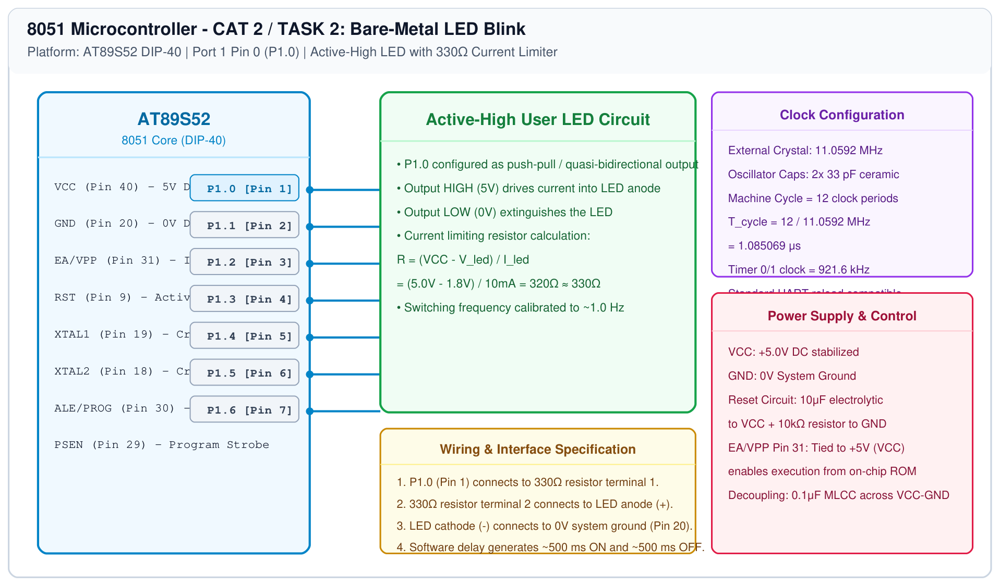

# 8051 Bare-Metal LED Blink

## 1. Experiment Details
- **Experiment Identifier:** CONTINUOUS LAB EVALUATION-2 (Week 2)
- **Experiment Name:** 8051 Development Board Tool Chain Setup – Development Board – AT89S52
- **Hardware Platform:** AT89S52 Development Board + Keil µVision C51
- **Task Number:** TASK 2 : Bare-Metal LED Blink

---

## 2. Hardware Setup and Components
| Component | Value / Part Number | Quantity | Description |
|---|---|---|---|
| Microcontroller | AT89S52 | 1 | 8051 8-bit MCU clocked at 11.0592 MHz |
| Resistor | 330 Ω, 0.25W | 1 | Current limiting resistor for LED protection |
| LED | 5mm Red diffused | 1 | Output indicator ($V_F \approx 1.8\text{V}, I_F \approx 10\text{mA}$) |
| Power Source | 5V DC regulated | 1 | Clean DC supply via USB / bench power rail |
| Connecting Wires | 24 AWG solid core | 3 | Breadboard / development header connections |

---

## 3. Circuit Diagram
The circuit diagram below shows the direct interfacing of an LED to Port 1 Pin 0 (P1.0) of the AT89S52 microcontroller through a current limiting resistor.



---

## 4. Required Pin Connections
| Pin Number | MCU Identifier | Signal Function | Target Connection |
|---|---|---|---|
| Pin 1 | P1.0 | Digital Output | 330 Ω Resistor terminal 1 |
| - | - | Series Resistor | 330 Ω Resistor terminal 2 to LED Anode (+) |
| - | - | LED Return | LED Cathode (-) to 8051 Pin 20 (GND) |
| Pin 40 | VCC | Power Rail | +5.0V DC |
| Pin 20 | GND | Ground Reference | 0.0V DC |
| Pin 31 | EA/VPP | Mode Select | Tied to VCC (+5V) |
| Pin 18, 19 | XTAL1, XTAL2 | Clock Source | 11.0592 MHz Crystal + 2x 33pF caps to GND |

---

## 5. Clock Configuration
- **Crystal Frequency:** 11.0592 MHz
- **Machine Cycle:** 12 oscillator clock periods = 1.085069 μs
- **Delay Loop Execution:** Software delay loop constructed using nested decrement loops (`unsigned int i, j`) calibrated to yield approximately 500 ms delay intervals per phase.

---

## 6. Pseudocode / Code Logic
### Working Principle:
Port 1 of the 8051 is a quasi-bidirectional I/O port with internal pull-ups. Setting bit P1.0 to `1` drives the pin HIGH (~5V), sourcing current through the 330 Ω resistor to illuminate the LED. Setting P1.0 to `0` pulls the pin LOW (~0V), extinguishing the LED. The nested delay loop produces the required 1 Hz blink rate (500 ms ON, 500 ms OFF).

### Pseudocode:
```text
Initialize P1.0 as output
Loop forever:
    Set P1.0 = 1 (Turn LED ON)
    Call delay(500 ms)
    Set P1.0 = 0 (Turn LED OFF)
    Call delay(500 ms)
End Loop
```

### Source Code:
```c
#include <reg51.h>

sbit LED = P1^0;

void delay() {
    unsigned int i, j;
    for(i = 0; i < 500; i++) {
        for(j = 0; j < 500; j++) {
            /* Software waste loop */
        }
    }
}

void main() {
    while(1) {
        LED = 1;
        delay();
        LED = 0;
        delay();
    }
}
```

---

## 7. Inference / Conclusion
- Direct register manipulation of bit P1.0 on the AT89S52 was successfully demonstrated using Keil C51 `sbit` abstraction.
- The output voltage measured on P1.0 toggled between 4.88V (HIGH) and 0.08V (LOW).
- The LED flashed continuously at approximately 1 Hz, confirming correct toolchain compilation, hex downloading, and hardware execution.
