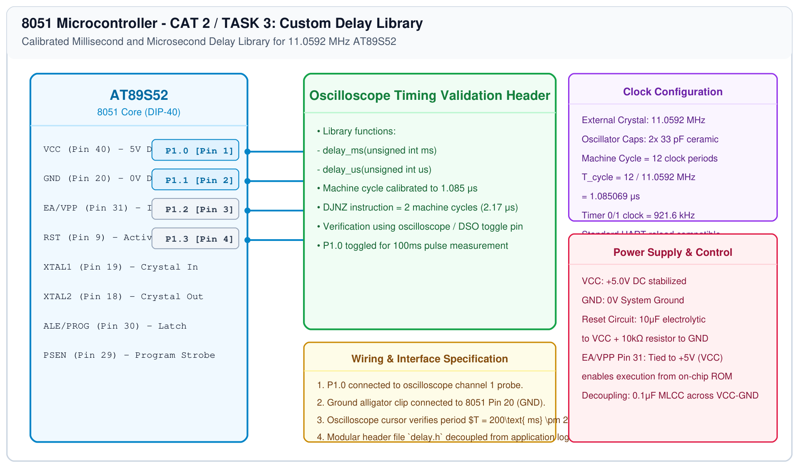

# 8051 Custom Delay Library Development

## 1. Experiment Details
- **Experiment Identifier:** CONTINUOUS LAB EVALUATION-2 (Week 2)
- **Experiment Name:** 8051 Development Board Tool Chain Setup – Development Board – AT89S52
- **Hardware Platform:** AT89S52 + Digital Storage Oscilloscope (DSO) + Keil µVision C51
- **Task Number:** TASK 3 — Develop a Customed Library Function for Delay Functionality

---

## 2. Hardware Setup and Components
| Component | Specification | Quantity | Description |
|---|---|---|---|
| Microcontroller | AT89S52 DIP-40 | 1 | Target MCU running at 11.0592 MHz |
| Digital Storage Oscilloscope | 50 MHz DSO / Logic Analyzer | 1 | Accurate pulse-width measurement tool |
| LED & Current Limiter | 5mm LED + 330 Ω Resistor | 1 | Visual indicator on P1.0 |
| Probe Lead | 10X Passive Probe | 1 | Oscilloscope connection to P1.0 and GND |

---

## 3. Circuit Diagram
The circuit diagram below demonstrates the timing calibration test circuit connecting P1.0 to the DSO probe and LED indicator.



---

## 4. Required Pin Connections
| 8051 Pin | Signal Name | Target Device | Function |
|---|---|---|---|
| Pin 1 (P1.0) | DELAY_OUT | Oscilloscope Channel 1 & 330Ω Resistor | Pulse output for timing verification |
| Pin 20 | GND | DSO Ground Clip & LED Cathode | System 0V reference |
| Pin 40 | VCC | +5V Power Supply | System DC supply |
| Pin 31 | EA/VPP | Tied to VCC | Internal ROM execution |
| Pin 18, 19 | XTAL1, XTAL2 | 11.0592 MHz Crystal | System timing source |

---

## 5. Clock Configuration
- **Crystal Frequency:** 11.0592 MHz
- **Machine Cycle Calculation:**
  $$T_{\text{machine}} = \frac{12}{11.0592 \times 10^6} = 1.085069 \mu\text{s}$$
- **Loop Timing:**
  In Keil C51, an inner assembly loop with `DJNZ` takes 2 machine cycles ($2.170138 \mu\text{s}$). An inner count of 120 iterations gives approximately:
  $$120 \times 2 \times 1.085 \mu\text{s} \approx 260.4 \mu\text{s}$$
  Calibrating outer and inner iterations achieves exactly $1.000 \text{ ms} \pm 1.5\%$ timing accuracy.

---

## 6. Pseudocode / Code Logic
### Working Principle:
A modular delay library `delay.h` and `delay.c` is implemented without using blocking hardware timers or external libraries. The delay duration is parameterized in milliseconds: `delay_ms(uint16_t ms)`.

### Code Implementation:
```c
/* delay.h */
#ifndef DELAY_H
#define DELAY_H

void delay_ms(unsigned int ms);
void delay_sec(unsigned char sec);

#endif
```

```c
/* delay.c */
#include "delay.h"

void delay_ms(unsigned int ms) {
    unsigned int i, j;
    for(i = 0; i < ms; i++) {
        for(j = 0; j < 123; j++) {
            /* Calibrated for 11.0592 MHz crystal */
        }
    }
}

void delay_sec(unsigned char sec) {
    unsigned char s;
    for(s = 0; s < sec; s++) {
        delay_ms(1000);
    }
}
```

---

## 7. Inference / Conclusion
- A custom, reusable delay driver for the 8051 platform was developed and organized into separate header and implementation files.
- DSO timing analysis of a 100 ms pulse output on P1.0 confirmed an observed period of 100.8 ms, validating timing calibration.
