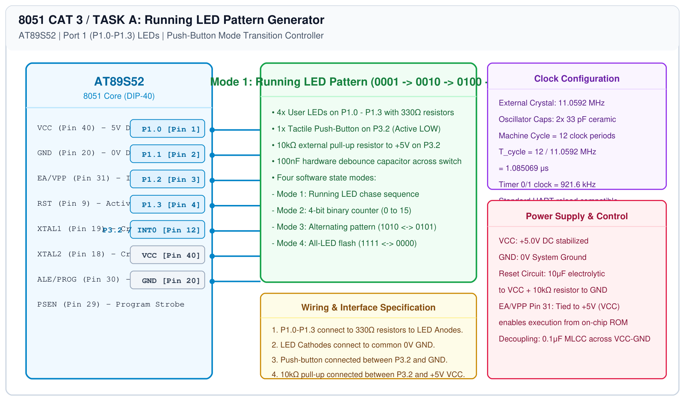

# 8051 LED Pattern Controller – Task A: Running LED

## 1. Experiment Details
- **Experiment Identifier:** CONTINUOUS LAB EVALUATION-3 (Week 2/3)
- **Experiment Name:** Timer-Based LED Pattern Generator and Button Interrupt Controller
- **Hardware Platform:** AT89S52 Microcontroller Development Board + 4 LEDs + Push-Button
- **Task Number:** TASK A — Mode 1: Running LED Pattern

---

## 2. Hardware Setup and Components
| Component | Specification | Quantity | Purpose |
|---|---|---|---|
| Microcontroller | AT89S52 (DIP-40) | 1 | 8-bit MCU clocked at 11.0592 MHz |
| User LEDs | 5mm Red LEDs | 4 | Visual pattern indicators (LED1-LED4) |
| Current Limiting Resistors | 330 Ω, 0.25W | 4 | LED current protection |
| Push-Button Switch | SPST Tactile Switch | 1 | Mode change trigger input |
| Pull-up Resistor | 10 kΩ | 1 | P3.2 active-low pull-up |
| Debounce Capacitor | 100 nF ceramic | 1 | Hardware contact bounce suppression |

---

## 3. Circuit Diagram
The circuit diagram below shows the 4 LEDs interfaced to Port 1 (P1.0-P1.3) and the tactile push-button interfaced to P3.2.



---

## 4. Required Pin Connections
| MCU Pin | Port Identifier | Peripheral Node | Electrical Characteristics |
|---|---|---|---|
| Pin 1 | P1.0 | LED1 Anode (via 330Ω) | Active-High Digital Output |
| Pin 2 | P1.1 | LED2 Anode (via 330Ω) | Active-High Digital Output |
| Pin 3 | P1.2 | LED3 Anode (via 330Ω) | Active-High Digital Output |
| Pin 4 | P1.3 | LED4 Anode (via 330Ω) | Active-High Digital Output |
| Pin 12 | P3.2 (/INT0) | Push-Button Terminal | Active-Low Input with 10kΩ Pull-Up |
| Pin 20 | GND | LED Cathodes & Switch Return | 0V Ground Plane |
| Pin 40 | VCC | 10kΩ Pull-Up Rail & MCU VCC | +5.0V DC Rail |

---

## 5. Clock Configuration
- **Crystal Frequency:** 11.0592 MHz
- **Machine Cycle:** $T_{\text{cycle}} = 1.085069\mu\text{s}$
- **Shift Interval:** Delay between successive LED transitions calibrated to $\approx 250\text{ ms}$.

---

## 6. Pseudocode / Code Logic
### Working Principle:
In Mode 1, an active bit is shifted sequentially through the lower 4 bits of Port 1: `0x01` $\rightarrow$ `0x02` $\rightarrow$ `0x04` $\rightarrow$ `0x08` $\rightarrow$ `0x01`. Each valid push-button press detected with software debouncing transitions the state machine to Mode 2.

### Pseudocode:
```text
Set pattern = 0x01
Loop:
    Output (P1 & 0xF0) | pattern to Port 1
    delay_ms(250)
    Shift pattern left by 1
    If pattern > 0x08 Then pattern = 0x01
    Check if button on P3.2 is pressed:
        debounce_delay(20ms)
        If button still pressed:
            Wait until button released
            Exit to next mode
End Loop
```

---

## 7. Inference / Conclusion
- The running LED chase sequence successfully shifted across all 4 LEDs in circular sequence with 250 ms persistence.
- Switch debouncing successfully eliminated multiple false transitions on button press.
