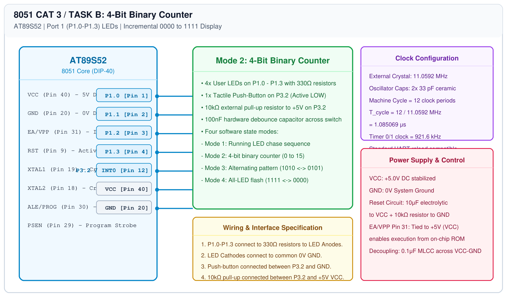

# 8051 LED Pattern Controller – Task B: Binary Counter

## 1. Experiment Details
- **Experiment Identifier:** CONTINUOUS LAB EVALUATION-3 (Week 2/3)
- **Experiment Name:** Timer-Based LED Pattern Generator and Button Interrupt Controller
- **Hardware Platform:** AT89S52 Microcontroller Development Board + 4 LEDs + Push-Button
- **Task Number:** TASK B — Mode 2: 4-Bit Binary Counter (0 to 15)

---

## 2. Hardware Setup and Components
| Component | Specification | Quantity | Function |
|---|---|---|---|
| Microcontroller | AT89S52 | 1 | Target 8-bit MCU clocked at 11.0592 MHz |
| 4-LED Array | 5mm Red LEDs | 4 | Binary digit display ($2^0$ to $2^3$) |
| Current Limiting Resistors | 330 Ω | 4 | Protection resistors on P1.0 to P1.3 |
| Push-Button | Tactile momentary | 1 | Mode selection switch on P3.2 |

---

## 3. Circuit Diagram


---

## 4. Required Pin Connections
| Pin Number | Port Pin | Binary Weight | Connection |
|---|---|---|---|
| Pin 1 | P1.0 | Bit 0 (LSB - $2^0$) | LED1 Anode through 330Ω |
| Pin 2 | P1.1 | Bit 1 ($2^1$) | LED2 Anode through 330Ω |
| Pin 3 | P1.2 | Bit 2 ($2^2$) | LED3 Anode through 330Ω |
| Pin 4 | P1.3 | Bit 3 (MSB - $2^3$) | LED4 Anode through 330Ω |
| Pin 12 | P3.2 | Switch Input | Tactile Button to GND (10kΩ pull-up) |
| Pin 20 | GND | Ground Reference | 0V System Ground |

---

## 5. Clock Configuration
- **Crystal Oscillator:** 11.0592 MHz ($T_{\text{cycle}} = 1.085\mu\text{s}$)
- **Count Interval:** Counter increments every 500 ms through software delay loops.

---

## 6. Pseudocode / Code Logic
```text
count = 0
Loop:
    Output (P1 & 0xF0) | (count & 0x0F) to P1
    delay_ms(500)
    count = (count + 1) modulo 16
    If button pressed Then advance to Mode 3
End Loop
```

---

## 7. Inference / Conclusion
- The 4-bit binary counter correctly iterated through states `0000_2` ($0$) to `1111_2` ($15$) with automatic roll-over to `0000_2`.
- Direct masking (`P1 = (P1 & 0xF0) | count`) preserved upper port integrity.
