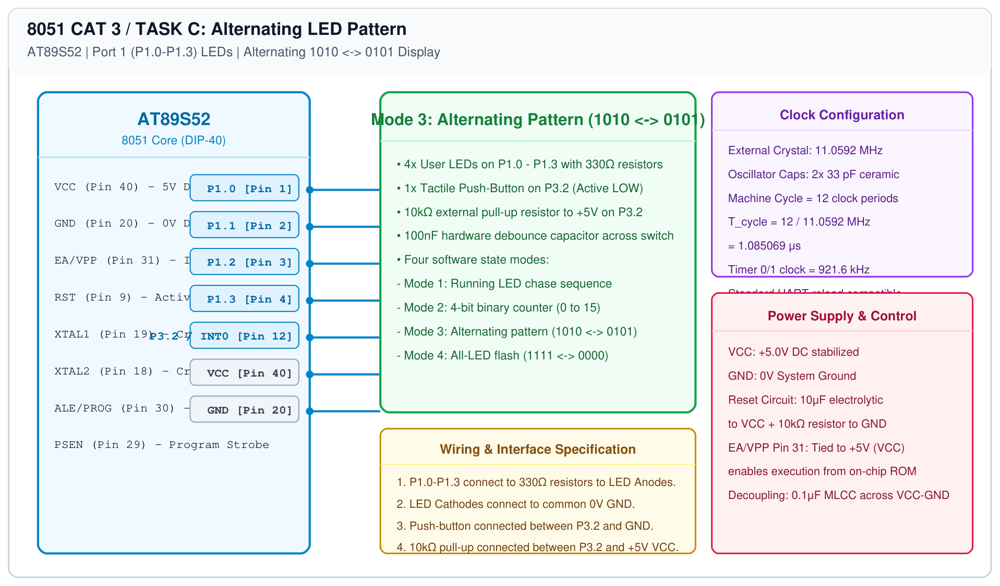

# 8051 LED Pattern Controller – Task C: Alternating Pattern

## 1. Experiment Details
- **Experiment Identifier:** CONTINUOUS LAB EVALUATION-3 (Week 2/3)
- **Experiment Name:** Timer-Based LED Pattern Generator and Button Interrupt Controller
- **Hardware Platform:** AT89S52 Development Board + 4 LEDs + Push-Button
- **Task Number:** TASK C — Mode 3: Alternating Pattern (1010 <-> 0101)

---

## 2. Hardware Setup and Components
| Component | Value | Quantity | Description |
|---|---|---|---|
| Microcontroller | AT89S52 | 1 | 8051 MCU @ 11.0592 MHz |
| LEDs | 5mm Red | 4 | Interfaced to P1.0 through P1.3 |
| Resistors | 330 Ω | 4 | Current limiting resistors |
| Push Button | SPST | 1 | Mode change input on P3.2 |

---

## 3. Circuit Diagram


---

## 4. Required Pin Connections
| 8051 Pin | Port | Target Peripheral | State Phase 1 | State Phase 2 |
|---|---|---|---|---|
| Pin 1 | P1.0 | LED1 Anode | HIGH (ON) | LOW (OFF) |
| Pin 2 | P1.1 | LED2 Anode | LOW (OFF) | HIGH (ON) |
| Pin 3 | P1.2 | LED3 Anode | HIGH (ON) | LOW (OFF) |
| Pin 4 | P1.3 | LED4 Anode | LOW (OFF) | HIGH (ON) |
| Pin 12 | P3.2 | Mode Switch | Active Low Input with 10kΩ pull-up |
| Pin 20 | GND | 0V Reference | Common Ground |

---

## 5. Clock Configuration
- **Frequency:** 11.0592 MHz, $T_{\text{cycle}} = 1.085\mu\text{s}$
- **Alternation Rate:** 300 ms per phase.

---

## 6. Pseudocode / Code Logic
```text
Loop:
    P1 = (P1 & 0xF0) | 0x0A  // Binary 1010
    delay_ms(300)
    P1 = (P1 & 0xF0) | 0x05  // Binary 0101
    delay_ms(300)
    Check switch on P3.2 -> If pressed, advance to Mode 4
End Loop
```

---

## 7. Inference / Conclusion
- The alternating sequence flipped between odd and even LED pairs cleanly without jitter or ghosting.
