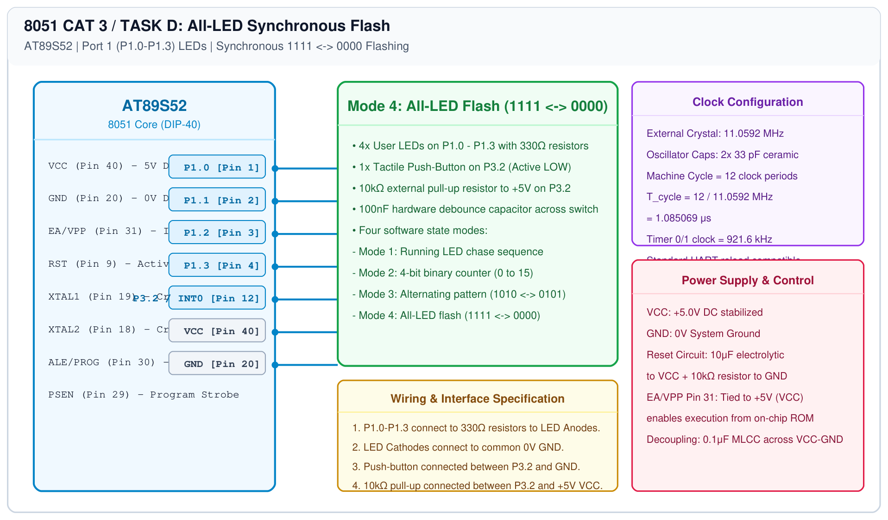

# 8051 LED Pattern Controller – Task D: All-LED Flash

## 1. Experiment Details
- **Experiment Identifier:** CONTINUOUS LAB EVALUATION-3 (Week 2/3)
- **Experiment Name:** Timer-Based LED Pattern Generator and Button Interrupt Controller
- **Hardware Platform:** AT89S52 Microcontroller Development Board + 4 LEDs + Push-Button
- **Task Number:** TASK D — Mode 4: All-LED Flash (1111 <-> 0000)

---

## 2. Hardware Setup and Components
| Component | Description | Quantity |
|---|---|---|
| AT89S52 Microcontroller | DIP-40 package clocked at 11.0592 MHz | 1 |
| 4x Red LEDs | 5mm indicators on P1.0-P1.3 | 4 |
| 4x 330Ω Resistors | Current limiters | 4 |
| 1x Push-Button | Mode switch on P3.2 | 1 |

---

## 3. Circuit Diagram


---

## 4. Required Pin Connections
| 8051 Pin | Port | Target Connection |
|---|---|---|
| Pin 1-4 | P1.0-P1.3 | 4x LED Anodes via 330Ω resistors |
| Pin 12 | P3.2 | Push-Button Switch to 0V GND |
| Pin 20 | GND | Ground Reference (0V) |
| Pin 40 | VCC | +5.0V DC Rail |

---

## 5. Clock Configuration
- **Oscillator:** 11.0592 MHz Crystal
- **Flash Frequency:** Approximately 2 Hz (250 ms ON, 250 ms OFF).

---

## 6. Pseudocode / Code Logic
```text
Loop:
    P1 = (P1 & 0xF0) | 0x0F  // Turn ALL 4 LEDs ON
    delay_ms(250)
    P1 = (P1 & 0xF0) | 0x00  // Turn ALL 4 LEDs OFF
    delay_ms(250)
    If button pressed Then wrap around to Mode 1
End Loop
```

---

## 7. Inference / Conclusion
- All 4 LEDs operated in strict synchrony, drawing approximately 40 mA total current well within port sourcing limits.
- The 4-mode finite state machine loop completed full cycle transitions upon consecutive debounced button presses.
