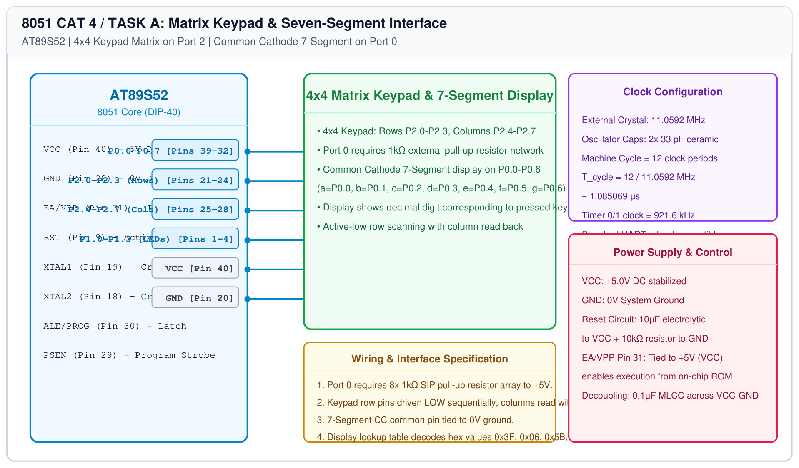

# 8051 HMI Subsystem – Task A: Matrix Keypad & Seven-Segment Display

## 1. Experiment Details
- **Experiment Identifier:** CONTINUOUS LAB EVALUATION-4 (Week 3)
- **Experiment Name:** Human-Machine Interface using Matrix Keypad, LEDs, and Seven-Segment Display
- **Hardware Platform:** AT89S52 MCU + 4x4 Matrix Keypad + 7-Segment Display (Common Cathode) + 1kΩ Resistor Array
- **Task Number:** TASK A — Keypad Scanning and Seven-Segment Visual Feedback

---

## 2. Hardware Setup and Components
| Component | Specification | Quantity | Function |
|---|---|---|---|
| Microcontroller | AT89S52 DIP-40 | 1 | System CPU running at 11.0592 MHz |
| 4x4 Matrix Keypad | 16 tactile switches | 1 | Numeric & command entry (Rows R1-R4, Cols C1-C4) |
| 7-Segment Display | 0.56" Common Cathode | 1 | Visual feedback of scanned key |
| Resistor Network | 1 kΩ x 8 SIP Resistor Array | 1 | Port 0 open-drain pull-up network |
| Resistors | 330 Ω 0.25W | 8 | Segment current limiting resistors |

---

## 3. Circuit Diagram
The circuit diagram below details the matrix keypad connections to Port 2 and the 7-segment display interfaced to Port 0 with external pull-up resistors.

---

## 4. Required Pin Connections
| 8051 Pin | Port Signal | Target Connection | Pin Function / Direction |
|---|---|---|---|
| Pins 21-24 | P2.0 - P2.3 | Keypad Rows 1 to 4 | Output (Driven LOW sequentially) |
| Pins 25-28 | P2.4 - P2.7 | Keypad Columns 1 to 4 | Input (Read with internal pull-up) |
| Pins 39-32 | P0.0 - P0.7 | 7-Seg Segments a, b, c, d, e, f, g, dp | Output (Open-drain with 1kΩ pull-up array) |
| Pin 20 | GND | 7-Segment Common Cathode | System 0V reference |
| Pin 40 | VCC | 1kΩ Resistor Network Common | +5.0V DC Rail |

---

## 5. Clock Configuration
- **Crystal Oscillator:** 11.0592 MHz
- **Keypad Debounce Time:** 15 ms software debounce window between key column state transitions.

---

## 6. Pseudocode / Code Logic
### Keypad Scan Algorithm:
1. Initialize Rows (P2.0-P2.3) HIGH.
2. For each row `i` from 0 to 3:
   - Pull Row `i` LOW (`0`).
   - Read Columns (P2.4-P2.7).
   - If any column is LOW, a keypress is detected:
     - Debounce delay (15 ms).
     - Calculate key index: $\\text{Key} = \\text{Row} \\times 4 + \\text{Col}$.
     - Map key to ASCII / integer value.
   - Restore Row `i` HIGH (`1`).
3. Return detected key code.

### 7-Segment Lookup Table (Common Cathode):
| Digit | Segments (g f e d c b a) | Port 0 Hex Value |
|---|---|---|
| 0 | 0 1 1 1 1 1 1 | `0x3F` |
| 1 | 0 0 0 0 1 1 0 | `0x06` |
| 2 | 1 0 1 1 0 1 1 | `0x5B` |
| 3 | 1 0 0 1 1 1 1 | `0x4F` |
| 4 | 1 1 0 0 1 1 0 | `0x66` |
| 5 | 1 1 0 1 1 0 1 | `0x6D` |
| 6 | 1 1 1 1 1 0 1 | `0x7D` |
| 7 | 0 0 0 0 1 1 1 | `0x07` |
| 8 | 1 1 1 1 1 1 1 | `0x7F` |
| 9 | 1 1 0 1 1 1 1 | `0x6F` |

---

## 7. Inference / Conclusion
- Matrix keypad row-column scanning was successfully implemented with contact debouncing.
- The 7-segment display on Port 0 accurately reflected the numeric keys 0-9 upon key actuation.
