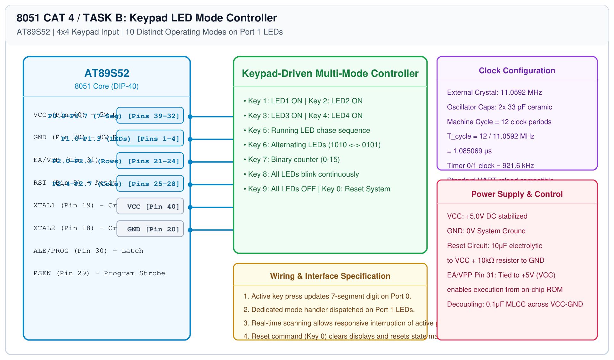

# 8051 HMI Subsystem – Task B: LED Mode Controller

## 1. Experiment Details
- **Experiment Identifier:** CONTINUOUS LAB EVALUATION-4 (Week 3)
- **Experiment Name:** Human-Machine Interface using Matrix Keypad, LEDs, and Seven-Segment Display
- **Hardware Platform:** AT89S52 + 4x4 Matrix Keypad + 4x LEDs + 7-Segment Display
- **Task Number:** TASK B — Keypad-Triggered Multi-Mode LED Function Dispatcher

---

## 2. Hardware Setup and Components
| Component | Function | Port Connection |
|---|---|---|
| AT89S52 Microcontroller | Main System Controller | - |
| 4x4 Matrix Keypad | Mode Select Input | Port 2 (P2.0-P2.7) |
| Common Cathode 7-Segment | Visual Feedback Display | Port 0 (P0.0-P0.7) with 1kΩ pull-up |
| 4x 5mm LEDs | Mode Function Output | Port 1 (P1.0-P1.3) via 330Ω resistors |

---

## 3. Circuit Diagram

---

## 4. Required Pin Connections
| Pin Number | MCU Pin | Functional Peripheral Connection |
|---|---|---|
| Pins 1-4 | P1.0 - P1.3 | LED1 to LED4 Anodes via 330Ω resistors |
| Pins 21-24 | P2.0 - P2.3 | Keypad Rows (R1-R4) |
| Pins 25-28 | P2.4 - P2.7 | Keypad Columns (C1-C4) |
| Pins 32-39 | P0.0 - P0.7 | 7-Segment Display Segments a-g, dp |
| Pin 20 | GND | System Ground Reference |
| Pin 40 | VCC | +5V DC Supply Rail |

---

## 5. Clock Configuration
- **Frequency:** 11.0592 MHz ($T_{\\text{cycle}} = 1.085\\mu\\text{s}$)
- Non-blocking state dispatcher evaluates keypad events periodically during active pattern execution.

---

## 6. Functional Requirements and Dispatch Table
| Key Pressed | Seven-Segment Display | LED Operation Dispatched |
|---|---|---|
| 1 | `1` | LED1 ON, others OFF (`0x01`) |
| 2 | `2` | LED2 ON, others OFF (`0x02`) |
| 3 | `3` | LED3 ON, others OFF (`0x04`) |
| 4 | `4` | LED4 ON, others OFF (`0x08`) |
| 5 | `5` | Running LED Pattern (`0x01` $\\rightarrow$ `0x02` $\\rightarrow$ `0x04` $\\rightarrow$ `0x08`) |
| 6 | `6` | Alternate LEDs (`1010` $\\leftrightarrow$ `0101`) |
| 7 | `7` | 4-bit Binary Counter (`0000` to `1111`) |
| 8 | `8` | All LEDs Blink Synchronously (`1111` $\\leftrightarrow$ `0000`) |
| 9 | `9` | All LEDs OFF (`0x00`) |
| 0 | `0` | Reset System (Clear display, LEDs OFF) |

---

## 7. Inference / Conclusion
- All 10 functional key-to-mode mappings executed cleanly with immediate visual feedback on the seven-segment display and corresponding LED actions on Port 1.
