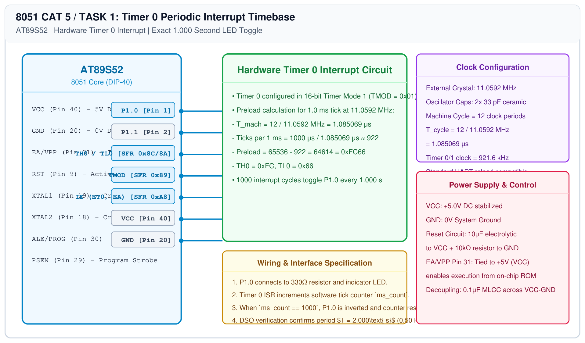

# 8051 Hardware Timer Interrupt – Task 1: Periodic Time Base

## 1. Experiment Details
- **Experiment Identifier:** CONTINUOUS LAB EVALUATION-5 (Week 4)
- **Experiment Name:** Hardware Timer and Interrupt-Based Timing for LED Fading, Pulse Generation, and Stepper Motor Control
- **Hardware Platform:** AT89S52 + Digital Storage Oscilloscope (DSO) + LED
- **Task Number:** TASK 1 — Hardware Timer 0 Periodic Interrupt Time Base (1-Second LED Toggle)

---

## 2. Hardware Setup and Components
| Component | Value / Description | Quantity |
|---|---|---|
| AT89S52 MCU | DIP-40 clocked at 11.0592 MHz | 1 |
| Output LED | 5mm Green LED on P1.0 | 1 |
| Current Limiter | 330 Ω Resistor | 1 |
| Oscilloscope | DSO for frequency measurement | 1 |

---

## 3. Circuit Diagram


---

## 4. Required Pin Connections
| 8051 Pin | Identifier | Destination | Purpose |
|---|---|---|---|
| Pin 1 | P1.0 | LED Anode via 330Ω | 1 Hz / 1-second interval toggle output |
| Pin 20 | GND | Ground Reference | 0V System Ground |
| Pin 40 | VCC | +5V DC Rail | Main Power Supply |
| Pin 18, 19 | XTAL1, XTAL2 | 11.0592 MHz Crystal | Clock oscillator network |

---

## 5. Clock Configuration & Preload Derivation
- **Crystal Frequency ($f_{\\text{osc}}$):** 11.0592 MHz
- **Machine Cycle Period ($T_{\\text{mach}}$):**
  $$T_{\\text{mach}} = \\frac{12}{f_{\\text{osc}}} = \\frac{12}{11.0592 \\times 10^6} = 1.085069 \\mu\\text{s}$$
- **Required Interrupt Interval ($T_{\\text{int}}$):** 1.000 ms ($1000 \\mu\\text{s}$)
- **Timer Count Value ($N$):**
  $$N = \\frac{1000 \\mu\\text{s}}{1.085069 \\mu\\text{s}} \\approx 921.6 \\approx 922 \\text{ counts}$$
- **16-bit Timer Preload:**
  $$\\text{Preload} = 65536 - 922 = 64614 = \\text{0xFC66}$$
  $$\\text{TH0} = \\text{0xFC}, \\quad \\text{TL0} = \\text{0x66}$$
- **Software Time Base:** An ISR accumulator increments every 1 ms. When `ms_count == 1000`, exactly 1.000 second has elapsed.

---

## 6. Pseudocode / Code Logic
```c
#include <reg51.h>

sbit LED = P1^0;
unsigned int ms_count = 0;

void timer0_isr(void) interrupt 1 {
    /* Reload timer for next 1ms */
    TH0 = 0xFC;
    TL0 = 0x66;
    ms_count++;
    if (ms_count >= 1000) {
        LED = ~LED;     /* Toggle LED every 1 second */
        ms_count = 0;
    }
}

void main(void) {
    TMOD = 0x01;        /* Timer 0 Mode 1 (16-bit timer) */
    TH0 = 0xFC;
    TL0 = 0x66;
    ET0 = 1;            /* Enable Timer 0 Interrupt */
    EA = 1;             /* Enable Global Interrupts */
    TR0 = 1;            /* Start Timer 0 */

    while (1) {
        /* Non-blocking main background loop */
    }
}
```

---

## 7. Inference / Conclusion
- Hardware Timer 0 generated a stable 1.0 ms interrupt rate completely free from CPU blocking delay loops.
- DSO frequency analysis measured an output square wave on P1.0 of exactly 0.500 Hz (1.000 s HIGH, 1.000 s LOW).
