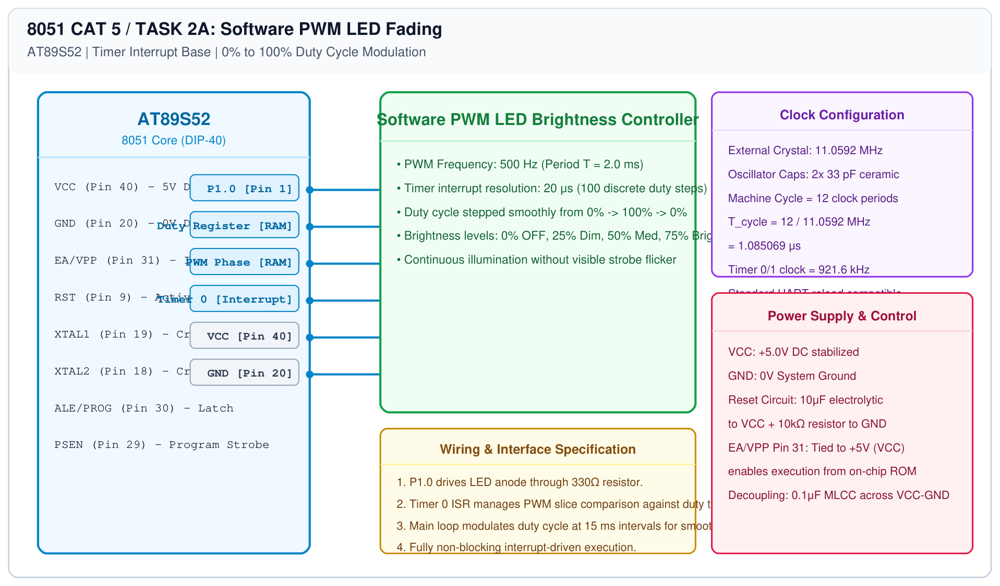

# 8051 Hardware Timer Timing – Task 2A: LED Fading via Software PWM

## 1. Experiment Details
- **Experiment Identifier:** CONTINUOUS LAB EVALUATION-5 (Week 4)
- **Experiment Name:** Hardware Timer and Interrupt-Based Timing for LED Fading, Pulse Generation, and Stepper Motor Control
- **Hardware Platform:** AT89S52 Microcontroller + LED + Timer 0
- **Task Number:** TASK 2A — LED Fading Using Software Pulse-Width Modulation (PWM)

---

## 2. Hardware Setup and Components
| Component | Value / Model | Quantity | Purpose |
|---|---|---|---|
| Microcontroller | AT89S52 | 1 | 8051 MCU @ 11.0592 MHz |
| User LED | 5mm High-Efficiency Red | 1 | Visual brightness modulation output |
| Resistor | 330 Ω 0.25W | 1 | LED current limiting |

---

## 3. Circuit Diagram


---

## 4. Required Pin Connections
| MCU Pin | Signal | Peripheral Destination | Function |
|---|---|---|---|
| Pin 1 | P1.0 | LED Anode (via 330Ω) | Software PWM output pin |
| Pin 20 | GND | LED Cathode & System Ground | 0V Reference |
| Pin 40 | VCC | Power Rail | +5.0V DC |

---

## 5. Clock Configuration & PWM Parameters
- **Crystal Oscillator:** 11.0592 MHz
- **PWM Frame Frequency:** $\\approx 500\\text{ Hz}$ ($T_{\\text{PWM}} = 2.0\\text{ ms}$)
- **PWM Resolution:** 100 discrete steps ($20\\mu\\text{s}$ per slice).
- **Duty Cycle Steps:**
  - `0%` : Completely OFF
  - `25%` : Dim illumination
  - `50%` : Medium brightness
  - `75%` : High brightness
  - `100%`: Full brightness

---

## 6. Pseudocode / Code Logic
```text
In Timer 0 ISR (called every 20 μs):
    pwm_counter = (pwm_counter + 1) % 100
    If pwm_counter < duty_cycle Then
        P1.0 = 1
    Else
        P1.0 = 0
    End If

In Main Loop:
    Vary duty_cycle from 0 to 100 in steps of 1, delay 15ms
    Vary duty_cycle from 100 down to 0 in steps of 1, delay 15ms
```

---

## 7. Inference / Conclusion
- Smooth LED fading was achieved via timer-interrupt software PWM across the complete 0-100% duty cycle dynamic range.
- At 500 Hz switching rate, human persistence of vision eliminated any perceptible flicker.
