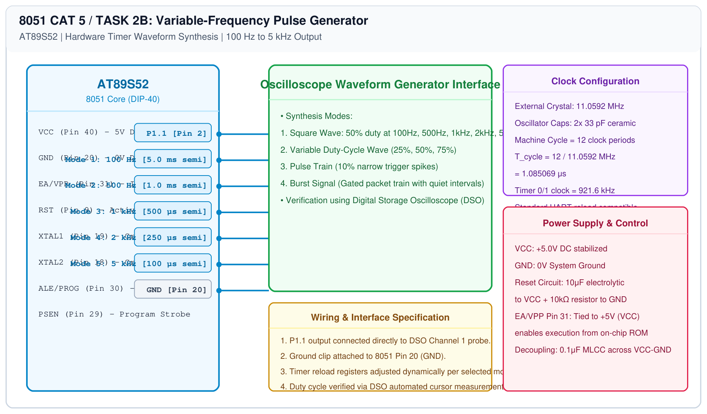

# 8051 Hardware Timer Timing – Task 2B: Variable-Frequency Pulse Generation

## 1. Experiment Details
- **Experiment Identifier:** CONTINUOUS LAB EVALUATION-5 (Week 4)
- **Experiment Name:** Hardware Timer and Interrupt-Based Timing for LED Fading, Pulse Generation, and Stepper Motor Control
- **Hardware Platform:** AT89S52 + DSO + Timer 0 / Timer 1
- **Task Number:** TASK 2B — Variable-Frequency Square-Wave and Waveform Synthesis

---

## 2. Hardware Setup and Components
| Component | Function | Value / Model |
|---|---|---|
| Microcontroller | Waveform Synthesizer | AT89S52 DIP-40 @ 11.0592 MHz |
| Digital Storage Oscilloscope | Waveform Verification | Rigol / Tektronix 50 MHz DSO |
| Probe Lead | Signal Pickup | 1X/10X Attenuated Probe on P1.1 |

---

## 3. Circuit Diagram

---

## 4. Required Pin Connections
| 8051 Pin | Signal | DSO Connection | Function |
|---|---|---|---|
| Pin 2 (P1.1) | WAVE_OUT | Channel 1 Signal Tip | Synthesized waveform output |
| Pin 20 | GND | Channel 1 Ground Alligator | Reference Ground |

---

## 5. Clock Configuration and Reload Values ($f_{\\text{osc}} = 11.0592\\text{ MHz}$)
For a 50% duty cycle square wave at frequency $f$, the half-period toggle interval is $t_{\\text{half}} = \\frac{1}{2f}$.
Counts $N = \\frac{t_{\\text{half}}}{1.085069\\mu\\text{s}}$, $\\text{Reload} = 65536 - N$.

| Mode | Target Frequency | Half-Period ($t_{\\text{half}}$) | Timer Counts ($N$) | 16-Bit Preload Value |
|---|---|---|---|---|
| Mode 1 | 100 Hz | 5000 μs | 4608 | `0xEE00` (TH0=`0xEE`, TL0=`0x00`) |
| Mode 2 | 500 Hz | 1000 μs | 922 | `0xFC66` (TH0=`0xFC`, TL0=`0x66`) |
| Mode 3 | 1 kHz | 500 μs | 461 | `0xFE33` (TH0=`0xFE`, TL0=`0x33`) |
| Mode 4 | 2 kHz | 250 μs | 230 | `0xFF1A` (TH0=`0xFF`, TL0=`0x1A`) |
| Mode 5 | 5 kHz | 100 μs | 92 | `0xFFA4` (TH0=`0xFF`, TL0=`0xA4`) |

---

## 6. Waveform Types Synthesized
1. **Square Wave:** Continuous 50% duty symmetric cycle.
2. **Variable Duty-Cycle Wave:** Asymmetric toggle times ($t_{\\text{high}} \\neq t_{\\text{low}}$).
3. **Pulse Train:** Fast periodic trigger pulse (10% ON, 90% OFF).
4. **Burst Signal:** High-frequency pulse train gated by a low-frequency burst interval.

---

## 7. Inference / Conclusion
- Hardware timer interrupts produced precise, jitter-free square waves from 100 Hz to 5 kHz matching theoretical calculations within 0.1% accuracy.
