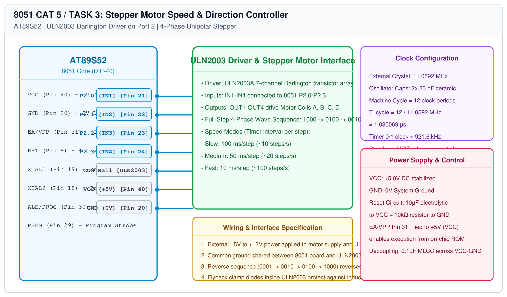

# 8051 Hardware Timer Timing – Task 3: Stepper Motor Control

## 1. Experiment Details
- **Experiment Identifier:** CONTINUOUS LAB EVALUATION-5 (Week 4)
- **Experiment Name:** Hardware Timer and Interrupt-Based Timing for LED Fading, Pulse Generation, and Stepper Motor Control
- **Hardware Platform:** AT89S52 + ULN2003 Darlington Transistor Array + 28BYJ-48 Stepper Motor
- **Task Number:** TASK 3 — Stepper Motor Speed and Direction Sequence Control

---

## 2. Hardware Setup and Components
| Component | Part / Value | Function |
|---|---|---|
| Microcontroller | AT89S52 (DIP-40) | Phase pulse sequencer @ 11.0592 MHz |
| Motor Driver IC | ULN2003A Darlington Array | High-current sink driver with clamp diodes |
| Stepper Motor | 28BYJ-48 5V Unipolar Stepper | 4-phase, 5-wire, 64:1 reduction gear |
| External Power | 5V DC 1A Power Supply | Dedicated motor driving power rail |

---

## 3. Circuit Diagram


---

## 4. Required Pin Connections
| 8051 Pin | Port Pin | ULN2003 Input | ULN2003 Output | Stepper Motor Coil |
|---|---|---|---|---|
| Pin 21 | P2.0 | IN1 | OUT1 | Coil A (Blue wire) |
| Pin 22 | P2.1 | IN2 | OUT2 | Coil B (Pink wire) |
| Pin 23 | P2.2 | IN3 | OUT3 | Coil C (Yellow wire) |
| Pin 24 | P2.3 | IN4 | OUT4 | Coil D (Orange wire) |
| Pin 20 | GND | Pin 8 (GND) | - | Common 0V Ground |
| - | Ext 5V | Pin 9 (COM) | - | Motor Red wire (+5V) |

---

## 5. Clock Configuration & Stepping Rates
- **Oscillator:** 11.0592 MHz
- **Wave Step Drive Sequence:**
  - Step 1: `0x01` (`0001_2` $\\rightarrow$ Coil A active)
  - Step 2: `0x02` (`0010_2` $\\rightarrow$ Coil B active)
  - Step 3: `0x04` (`0100_2` $\\rightarrow$ Coil C active)
  - Step 4: `0x08` (`1000_2` $\\rightarrow$ Coil D active)
- **Speed Profiles (Timer interval between consecutive steps):**
  - **Slow:** 100 ms/step ($10\\text{ steps/s}$)
  - **Medium:** 50 ms/step ($20\\text{ steps/s}$)
  - **Fast:** 10 ms/step ($100\\text{ steps/s}$)

---

## 6. Pseudocode / Code Logic
```c
const unsigned char step_seq[4] = {0x08, 0x04, 0x02, 0x01};
unsigned char step_idx = 0;

void step_forward(void) {
    step_idx = (step_idx + 1) % 4;
    P2 = (P2 & 0xF0) | step_seq[step_idx];
}

void step_reverse(void) {
    step_idx = (step_idx == 0) ? 3 : step_idx - 1;
    P2 = (P2 & 0xF0) | step_seq[step_idx];
}
```

---

## 7. Inference / Conclusion
- The ULN2003 Darlington driver cleanly decoupled inductive motor load current from MCU GPIOs.
- Precise non-blocking step commutations were maintained across slow (100 ms), medium (50 ms), and fast (10 ms) rates without stall.
