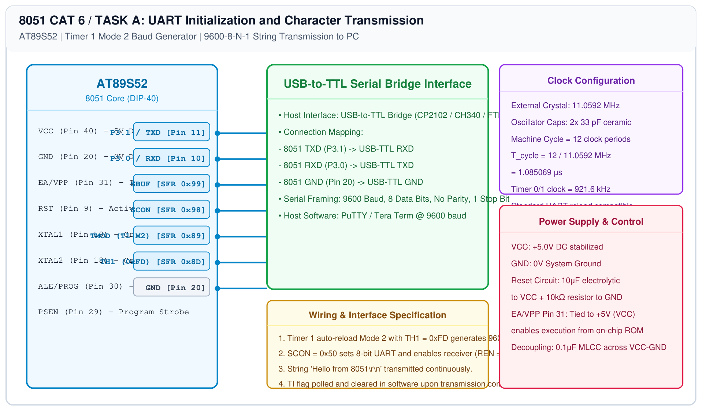

# 8051 UART Driver – Task A: Transmitter Bring-Up

## 1. Experiment Details
- **Experiment Identifier:** CONTINUOUS LAB EVALUATION-6 (Week 5)
- **Experiment Name:** UART Driver and Serial Debugging
- **Hardware Platform:** AT89S52 + USB-to-TTL Converter + PC Terminal (PuTTY)
- **Task Number:** TASK A — UART Initialization and Character Transmission ("Hello from 8051")

---

## 2. Hardware Setup and Components
| Component | Specification | Quantity | Description |
|---|---|---|---|
| Microcontroller | AT89S52 (DIP-40) | 1 | Target MCU running at 11.0592 MHz |
| Serial Bridge | CP2102 / CH340 USB-TTL | 1 | Converts 8051 TTL UART to PC USB COM port |
| Host PC | PuTTY Serial Terminal | 1 | Configured for 9600 baud, 8-N-1 |
| Jumper Wires | Female-to-Male | 3 | TXD, RXD, and GND connections |

---

## 3. Circuit Diagram


---

## 4. Required Pin Connections
| 8051 Pin | Signal Identifier | USB-to-TTL Pin | Direction / Purpose |
|---|---|---|---|
| Pin 11 | P3.1 / TXD | RXD | Serial Data Output from 8051 |
| Pin 10 | P3.0 / RXD | TXD | Serial Data Input to 8051 |
| Pin 20 | GND | GND | Common Reference Ground |
| Pin 40 | VCC | +5V (Optional) | Power Rail |

---

## 5. Clock Configuration and Baud Rate Derivation
- **Crystal Frequency:** 11.0592 MHz
- **UART Mode:** Mode 1 (8-bit UART, variable baud via Timer 1).
- **Timer 1 Mode:** Mode 2 (8-bit auto-reload, `TMOD |= 0x20`).
- **Baud Rate Equation:**
  $$\\text{Baud Rate} = \\frac{2^{\\text{SMOD}}}{32} \\times \\frac{f_{\\text{osc}}}{12 \\times (256 - \\text{TH1})}$$
  For SMOD = 0, $f_{\\text{osc}} = 11.0592\\text{ MHz}$, Target Baud = 9600 bps:
  $$9600 = \\frac{1}{32} \\times \\frac{11.0592 \\times 10^6}{12 \\times (256 - \\text{TH1})} = \\frac{28800}{256 - \\text{TH1}}$$
  $$256 - \\text{TH1} = \\frac{28800}{9600} = 3 \\implies \\text{TH1} = 256 - 3 = 253 = \\text{0xFD}$$
  Therefore: $\\text{TH1} = \\text{0xFD}$. Zero baud rate error!

---

## 6. Pseudocode / Code Logic
```text
Initialize UART:
    TMOD = 0x20  // Timer 1 Mode 2 auto-reload
    TH1 = 0xFD   // 9600 baud
    SCON = 0x50  // 8-bit UART, REN enabled
    TR1 = 1      // Start Timer 1
    TI = 1       // Set TI so first printf/write succeeds

Function uart_send_char(c):
    While TI == 0 Wait
    TI = 0
    SBUF = c

Function uart_send_string(s):
    While *s != '\0':
        uart_send_char(*s++)

Main Loop:
    uart_send_string("Hello from 8051\r\n")
    delay_ms(1000)
```

---

## 7. Inference / Conclusion
- The AT89S52 UART transmitter operated reliably at 9600-8-N-1 without character corruption or framing errors.
- PuTTY serial console consistently displayed "Hello from 8051" at 1-second intervals.
