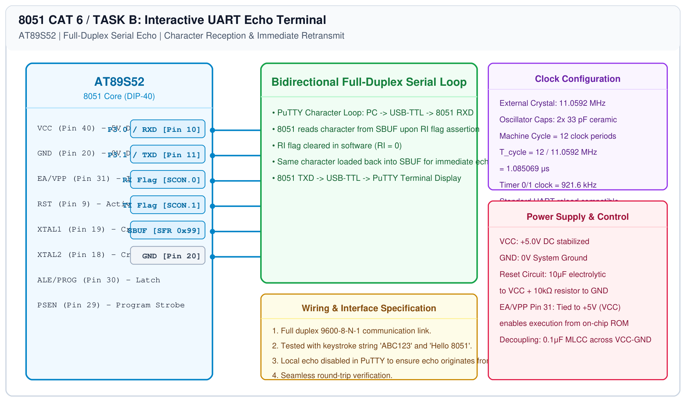

# 8051 UART Driver – Task B: Interactive UART Echo

## 1. Experiment Details
- **Experiment Identifier:** CONTINUOUS LAB EVALUATION-6 (Week 5)
- **Experiment Name:** UART Driver and Serial Debugging
- **Hardware Platform:** AT89S52 + USB-to-TTL Adapter + PuTTY Terminal
- **Task Number:** TASK B — Interactive UART Echo (PC -> 8051 -> PC)

---

## 2. Hardware Setup and Components
| Component | Function | Specifications |
|---|---|---|
| AT89S52 Microcontroller | Serial Echo Engine | 11.0592 MHz, DIP-40 |
| USB-TTL Adapter | Host PC Bridge | CP2102 / CH340 |
| Terminal Software | Keystroke Console | PuTTY (9600 baud, 8-N-1, Local Echo OFF) |

---

## 3. Circuit Diagram


---

## 4. Required Pin Connections
| 8051 Pin | Signal | Target Pin | Note |
|---|---|---|---|
| Pin 10 | P3.0 (RXD) | USB-TTL TXD | Inbound data from PC |
| Pin 11 | P3.1 (TXD) | USB-TTL RXD | Outbound echo to PC |
| Pin 20 | GND | USB-TTL GND | Reference ground |

---

## 5. Clock Configuration
- **Crystal Oscillator:** 11.0592 MHz
- **Timer 1 Auto-Reload:** $\\text{TH1} = \\text{0xFD}$ ($9600\\text{ Baud}$)
- **Serial Control Register:** $\\text{SCON} = \\text{0x50}$ (Mode 1, $\\text{REN}=1$)

---

## 6. Pseudocode / Code Logic
```text
Function uart_read_char():
    While RI == 0 Wait
    RI = 0
    Return SBUF

Function uart_send_char(c):
    While TI == 0 Wait
    TI = 0
    SBUF = c

Main Loop:
    c = uart_read_char()
    uart_send_char(c)  // Echo character back immediately
```

---

## 7. Inference / Conclusion
- Characters typed into the PuTTY terminal (`ABC123`, `Hello 8051`) were immediately received by the 8051 SBUF and returned to the display.
- Validated full-duplex UART driver operation on the AT89S52 platform.
