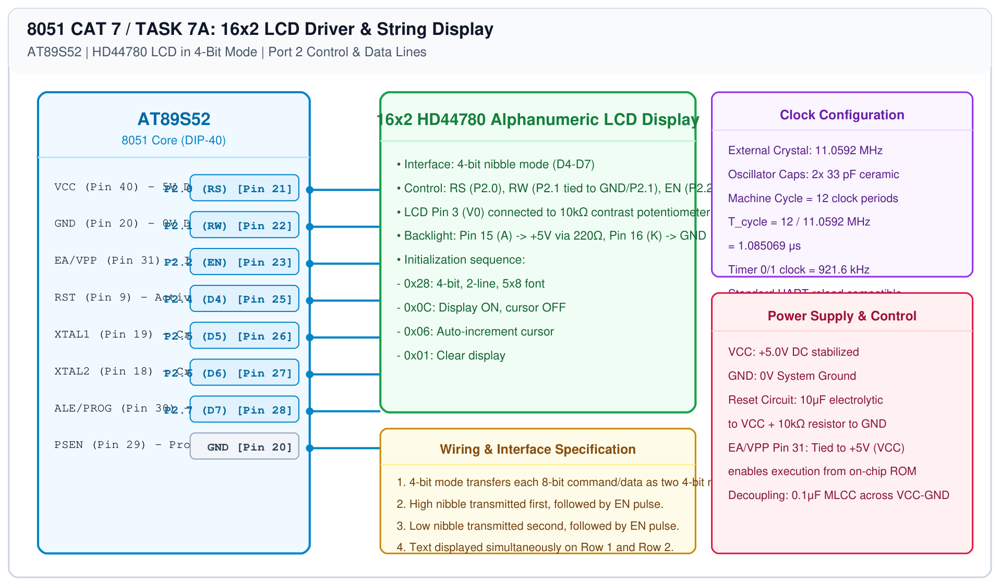

# 8051 LCD Driver – Task 7A: 4-Bit Driver & String Display

## 1. Experiment Details
- **Experiment Identifier:** CONTINUOUS LAB EVALUATION-7 (Week 6)
- **Experiment Name:** 16x2 LCD Driver Development and Dynamic Display Control
- **Hardware Platform:** AT89S52 + 16x2 HD44780 Alphanumeric LCD + 10kΩ Potentiometer
- **Task Number:** TASK 7A — 4-Bit GPIO-Based LCD Driver Initialization and Dual-Row String Display

---

## 2. Hardware Setup and Components
| Component | Description | Quantity |
|---|---|---|
| AT89S52 MCU | 8051 CPU running at 11.0592 MHz | 1 |
| 16x2 LCD Module | HD44780-compatible alphanumeric display | 1 |
| Potentiometer | 10 kΩ linear trim potentiometer (Contrast adjust) | 1 |
| Current Limiting Resistor | 220 Ω 0.25W (Backlight LED protection) | 1 |

---

## 3. Circuit Diagram


---

## 4. Required Pin Connections
| 8051 Pin | Port Pin | LCD Module Pin | Function |
|---|---|---|---|
| Pin 21 | P2.0 | Pin 4 (RS) | Register Select (0 = Command, 1 = Data) |
| Pin 22 | P2.1 | Pin 5 (RW) | Read/Write (0 = Write, tied to GND) |
| Pin 23 | P2.2 | Pin 6 (EN) | Enable Strobe (High-to-Low pulse) |
| Pin 25 | P2.4 | Pin 11 (D4) | Data Bit 4 |
| Pin 26 | P2.5 | Pin 12 (D5) | Data Bit 5 |
| Pin 27 | P2.6 | Pin 13 (D6) | Data Bit 6 |
| Pin 28 | P2.7 | Pin 14 (D7) | Data Bit 7 |
| - | GND | Pin 1 (VSS) | Ground reference (0V) |
| - | +5V | Pin 2 (VDD) | +5V Logic supply |
| - | Pot Wiper | Pin 3 (V0) | Contrast adjustment voltage |

---

## 5. Clock Configuration & Command Sequence
- **Frequency:** 11.0592 MHz ($T_{\\text{cycle}} = 1.085\\mu\\text{s}$)
- **HD44780 4-bit Initialization Sequence:**
  1. Wait $> 15\\text{ ms}$ after VCC reaches 4.5V.
  2. Send `0x02` (Return Home / Initialize 4-bit mode).
  3. Send `0x28` (Function Set: 4-bit, 2-line, 5x8 font).
  4. Send `0x0C` (Display ON, cursor OFF, blink OFF).
  5. Send `0x06` (Entry Mode Set: Increment address, no shift).
  6. Send `0x01` (Clear Display, delay $> 2\\text{ ms}$).

---

## 6. Pseudocode / Code Logic
```text
Function lcd_send_nibble(nibble):
    P2 = (P2 & 0x0F) | (nibble & 0xF0)
    EN = 1; delay_us(1); EN = 0; delay_us(100)

Function lcd_cmd(cmd):
    RS = 0
    lcd_send_nibble(cmd & 0xF0)
    lcd_send_nibble((cmd << 4) & 0xF0)

Function lcd_data(data):
    RS = 1
    lcd_send_nibble(data & 0xF0)
    lcd_send_nibble((data << 4) & 0xF0)
```

---

## 7. Inference / Conclusion
- 4-bit GPIO communication reduced the required microcontroller I/O pin count from 11 pins (8-bit mode) to only 6 pins.
- Clean text was successfully presented across both rows of the 16x2 LCD display.
