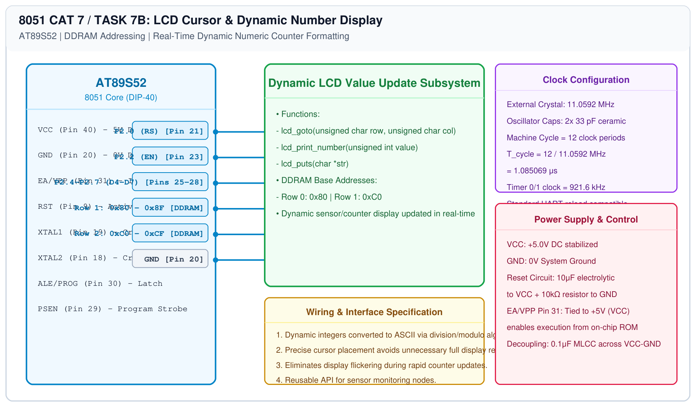

# 8051 LCD Driver – Task 7B: Cursor Positioning & Dynamic Numeric Output

## 1. Experiment Details
- **Experiment Identifier:** CONTINUOUS LAB EVALUATION-7 (Week 6)
- **Experiment Name:** 16x2 LCD Driver Development and Dynamic Display Control
- **Hardware Platform:** AT89S52 + 16x2 LCD Module
- **Task Number:** TASK 7B — LCD Cursor Positioning and Dynamic Value Update Functions

---

## 2. Hardware Setup and Components
| Component | Function | Connection |
|---|---|---|
| AT89S52 Microcontroller | Display Controller | Port 2 (P2.0, P2.2, P2.4-P2.7) |
| 16x2 Character LCD | Alphanumeric Display | HD44780 4-bit parallel bus |
| Potentiometer | Contrast Control | 10 kΩ on LCD Pin 3 (V0) |

---

## 3. Circuit Diagram


---

## 4. Required Pin Connections
| 8051 Pin | Signal | Target LCD Pin | Function |
|---|---|---|---|
| Pin 21 | P2.0 | Pin 4 (RS) | Register Select |
| Pin 23 | P2.2 | Pin 6 (EN) | Enable Clock Pulse |
| Pin 25 | P2.4 | Pin 11 (D4) | Data Bit 4 |
| Pin 26 | P2.5 | Pin 12 (D5) | Data Bit 5 |
| Pin 27 | P2.6 | Pin 13 (D6) | Data Bit 6 |
| Pin 28 | P2.7 | Pin 14 (D7) | Data Bit 7 |

---

## 5. Clock Configuration & DDRAM Address Mapping
- **System Clock:** 11.0592 MHz
- **HD44780 DDRAM Architecture:**
  - Row 0 (Top line): Addresses `0x00` to `0x0F` $\\rightarrow$ Command `0x80` to `0x8F`.
  - Row 1 (Bottom line): Addresses `0x40` to `0x4F` $\\rightarrow$ Command `0xC0` to `0xCF`.
- **Address Formula:**
  $$\\text{DDRAM Address} = (\\text{row} == 0) \\ ? \\ (0x80 + \\text{col}) : (0xC0 + \\text{col})$$

---

## 6. Pseudocode / Code Logic
```c
void lcd_goto(unsigned char row, unsigned char col) {
    if (row == 0) lcd_cmd(0x80 + (col & 0x0F));
    else if (row == 1) lcd_cmd(0xC0 + (col & 0x0F));
}

void lcd_print_number(unsigned int val) {
    char buf[6];
    int i = 0;
    if (val == 0) { lcd_data('0'); return; }
    while (val > 0) {
        buf[i++] = (val % 10) + '0';
        val /= 10;
    }
    while (i > 0) {
        lcd_data(buf[--i]);
    }
}
```

---

## 7. Inference / Conclusion
- Targeting specific DDRAM cells via `lcd_goto()` enabled targeted field updates without flickering.
- Dynamic numerical integers were successfully formatted and rendered on the bottom row.
