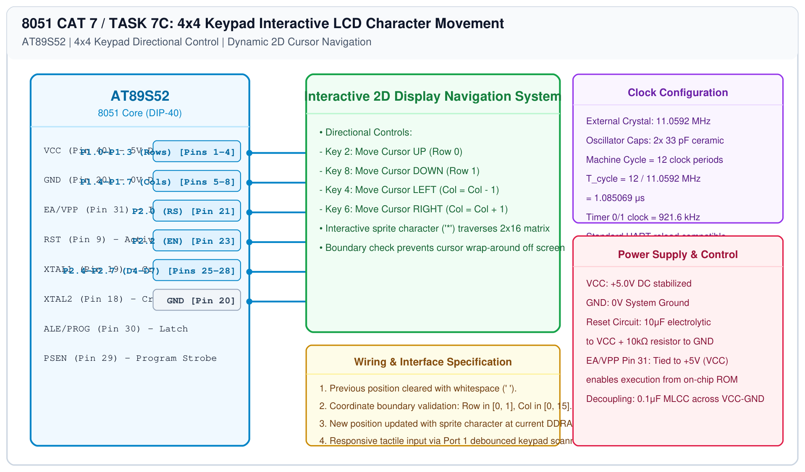

# 8051 LCD Driver – Task 7C: 4x4 Keypad Interactive Character Navigation

## 1. Experiment Details
- **Experiment Identifier:** CONTINUOUS LAB EVALUATION-7 (Week 6)
- **Experiment Name:** 16x2 LCD Driver Development and Dynamic Display Control
- **Hardware Platform:** AT89S52 + 16x2 LCD Module + 4x4 Matrix Keypad
- **Task Number:** TASK 7C — 4x4 Keypad-Based Interactive Character Movement Across 16x2 Display

---

## 2. Hardware Setup and Components
| Component | Function | Port Connection |
|---|---|---|
| AT89S52 MCU | Core Processor | - |
| 16x2 Character LCD | Visual 2D Grid | Port 2 (P2.0, P2.2, P2.4-P2.7) |
| 4x4 Matrix Keypad | Directional Controller | Port 1 (P1.0-P1.7) |
| 10kΩ Potentiometer | LCD Contrast Control | V0 Pin |

---

## 3. Circuit Diagram


---

## 4. Required Pin Connections
| 8051 Port | Function | Device Pin Connection |
|---|---|---|
| P1.0 - P1.3 | Keypad Rows (R1-R4) | Keypad Row Pins 1-4 |
| P1.4 - P1.7 | Keypad Columns (C1-C4) | Keypad Column Pins 5-8 |
| P2.0 | LCD RS | Pin 4 (RS) |
| P2.2 | LCD Enable | Pin 6 (EN) |
| P2.4 - P2.7 | LCD Data (D4-D7) | Pins 11-14 (D4-D7) |

---

## 5. Clock Configuration & Directional Keypad Mapping
- **Crystal Oscillator:** 11.0592 MHz
- **Navigation Controls:**
  - **Key `2` ($\uparrow$):** Move UP $\\rightarrow$ `row = 0`
  - **Key `8` ($\downarrow$):** Move DOWN $\\rightarrow$ `row = 1`
  - **Key `4` ($\leftarrow$):** Move LEFT $\\rightarrow$ `col = max(0, col - 1)`
  - **Key `6` ($\rightarrow$):** Move RIGHT $\\rightarrow$ `col = min(15, col + 1)`

---

## 6. Pseudocode / Code Logic
```text
Initialize row = 0, col = 0
Display '*' at (row, col)

Loop:
    key = keypad_scan()
    If key is valid:
        Clear previous position: write ' ' at (row, col)
        If key == 2: row = 0
        If key == 8: row = 1
        If key == 4 and col > 0: col = col - 1
        If key == 6 and col < 15: col = col + 1
        Write '*' at new (row, col)
End Loop
```

---

## 7. Inference / Conclusion
- Integrated matrix keypad scanning with LCD DDRAM positioning to create an interactive 2D cursor navigation application.
- Boundary enforcement maintained the cursor strictly within valid LCD screen coordinates.
