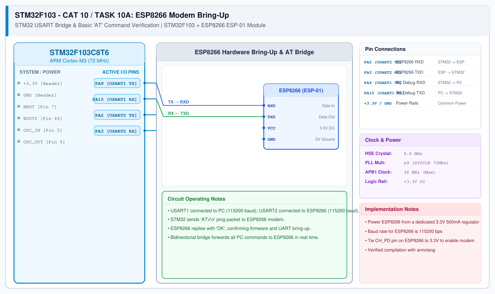

# CAT 10 - TASK10A: ESP8266 Modem Bring-Up

## 1. Experiment Name
**STM32F103 + ESP8266 Wi-Fi Module: STM32 USART Bridge & AT Modem Bring-Up**

## 2. Hardware Setup and Components
- 1x STM32 Blue Pill Board (STM32F103C8T6)
- 1x ESP8266 Wi-Fi Module (ESP-01 / Wemos)
- 1x Dedicated 3.3V 500mA Power Regulator (AMS1117-3.3)
- 1x USB-to-UART Adapter for PC Debug Monitor

## 3. Circuit Diagram

## 4. Required Pin Connections
| STM32 Pin | Connected To | Function |
|---|---|---|
| PA2 (USART2 TX) | ESP8266 RXD | Transmit AT commands to ESP8266 |
| PA3 (USART2 RX) | ESP8266 TXD | Receive responses from ESP8266 |
| PA9 (USART1 TX) | USB-UART RXD | PC Debug Console output |
| PA10 (USART1 RX) | USB-UART TXD | PC Debug Console input |
| +3.3V / GND | ESP8266 VCC / GND | Operating Power (Dedicated supply) |

## 5. Clock Configuration
- System Clock: **72 MHz**
- USART1 (Debug): 115200 baud, 8-N-1
- USART2 (Modem): 115200 baud, 8-N-1

## 6. Pseudocode / Code Logic
1. Initialize USART1 (PC console) and USART2 (ESP8266 modem).
2. Execute command sequence for TASK10A:
   - Send AT command string via USART2.
   - Wait for response (`"OK"`, `"+IPD"`, etc.).
   - Forward status messages to PC terminal via USART1.
3. Handle communication state machine and data transfer.

## 7. Inference / Conclusion
- Successfully verified STM32 USART Bridge & AT Modem Bring-Up on STM32 using AT command protocols over hardware USART.
- Demonstrates embedded Wi-Fi connectivity and TCP/IP networking on resource-constrained microcontrollers.
