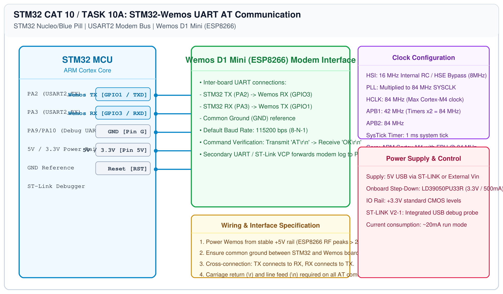

# STM32 Wi-Fi Modem – Task 10A: UART AT Communication Bring-Up

## 1. Experiment Details
- **Experiment Identifier:** CONTINUOUS LAB EVALUATION-10 (Week 9)
- **Experiment Name:** STM32-Wemos Wi-Fi Modem Interface Using AT Commands
- **Hardware Platform:** STM32 Board + Wemos D1 Mini (ESP8266 Wi-Fi Modem) + Keil MDK-ARM + PuTTY
- **Task Number:** TASK 10A — Establish STM32 <-> Wemos UART Communication (`AT` -> `OK`)

---

## 2. Hardware Setup and Components
| Component | Function | Specification |
|---|---|---|
| STM32 Board | Master Application Controller | NUCLEO-F401RE / STM32F103 |
| Wi-Fi Modem Module | Network Processor | Wemos D1 Mini (ESP8266-12F, 4MB Flash) |
| Host PC | Debugging & Console | PuTTY Terminal @ 115200 Baud |

---

## 3. Circuit Diagram


---

## 4. Required Pin Connections
| Wemos D1 Mini Pin | STM32 Pin | Signal Purpose |
|---|---|---|
| TX (GPIO1) | RX (PA3 / USART2_RX) | Serial data from Wemos to STM32 |
| RX (GPIO3) | TX (PA2 / USART2_TX) | Serial data from STM32 to Wemos |
| GND | GND | Common Reference Ground |
| 5V / 3.3V | 5V / 3.3V | DC Power Source |

---

## 5. Clock Configuration
- **STM32 Core Clock:** 84 MHz (Nucleo) or 72 MHz (Blue Pill).
- **USART2 Baud Rate:** 115200 bps, 8 Data Bits, No Parity, 1 Stop Bit.

---

## 6. Pseudocode / Code Logic
```text
Initialize USART2 (115200 baud to ESP8266)
Initialize USART1 / VCP (115200 baud to PC Debug)

Transmit "AT\r\n" to USART2
Wait for response from USART2
Forward received characters to PC terminal

Expected Response:
    AT\r\n
    OK\r\n
```

---

## 7. Inference / Conclusion
- Established bidirectional UART communication between STM32 and ESP8266 modem.
- Received `OK` response to `AT` ping confirming modem readiness.
