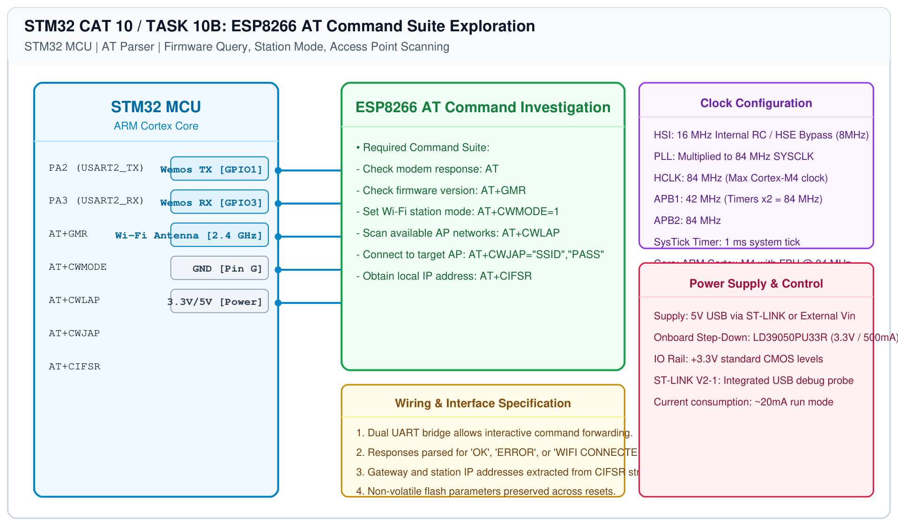

# STM32 Wi-Fi Modem – Task 10B: AT Command Exploration

## 1. Experiment Details
- **Experiment Identifier:** CONTINUOUS LAB EVALUATION-10 (Week 9)
- **Experiment Name:** STM32-Wemos Wi-Fi Modem Interface Using AT Commands
- **Hardware Platform:** STM32 + Wemos D1 Mini
- **Task Number:** TASK 10B — Explore the ESP8266 AT Command Interface

---

## 2. Hardware Setup and Components
| Component | Purpose |
|---|---|
| STM32 Development Board | UART Host Controller |
| Wemos D1 Mini (ESP8266) | AT Command Coprocessor |
| PC Serial Terminal | Interactive AT Command Monitor |

---

## 3. Circuit Diagram


---

## 4. Required Pin Connections
| STM32 Pin | Signal | Wemos Pin |
|---|---|---|
| PA2 | USART2_TX | RX (GPIO3) |
| PA3 | USART2_RX | TX (GPIO1) |
| GND | 0V | GND |
| 5V | +5V Rail | 5V |

---

## 5. AT Command Exploration Table
| Requirement | Prescribed AT Command | Expected Output Response |
|---|---|---|
| Check modem response | `AT` | `OK` |
| Check firmware / SDK version | `AT+GMR` | AT version, SDK version, compile time, `OK` |
| Set Wi-Fi station mode | `AT+CWMODE=1` | `OK` |
| Scan available Wi-Fi networks | `AT+CWLAP` | `+CWLAP:(ecn,ssid,rssi,mac,ch)... OK` |
| Connect to access point | `AT+CWJAP="SSID","PASS"` | `WIFI CONNECTED\r\nWIFI GOT IP\r\nOK` |
| Query assigned IP address | `AT+CIFSR` | `+CIFSR:STAIP,"192.168.x.x"\r\n+CIFSR:STAMAC,"..."\r\nOK` |

---

## 6. Pseudocode / Code Logic
```c
/* Command investigation sequence */
send_at_cmd("AT\r\n");
send_at_cmd("AT+GMR\r\n");
send_at_cmd("AT+CWMODE=1\r\n");
send_at_cmd("AT+CWLAP\r\n");
```

---

## 7. Inference / Conclusion
- Mastered low-level AT protocol interaction with the ESP8266 modem.
- Verified station mode configuration and network scanning capabilities.
