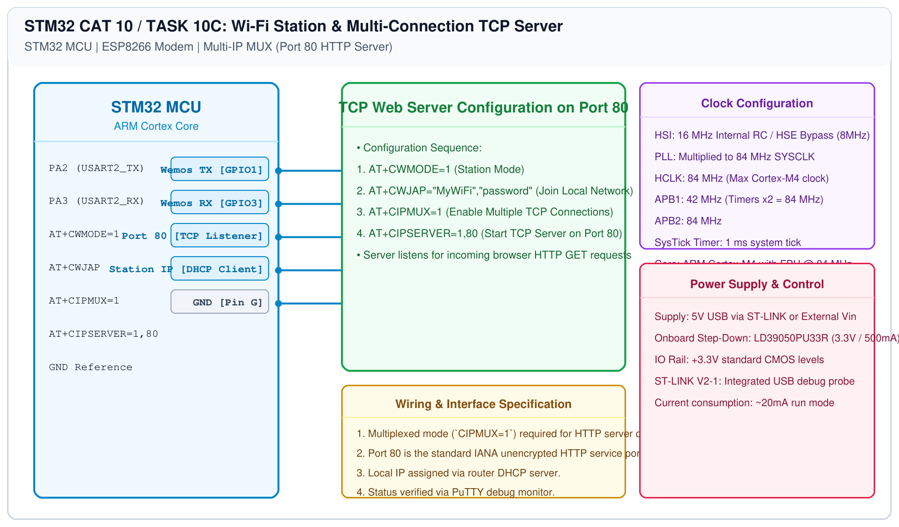

# STM32 Wi-Fi Modem – Task 10C: Wi-Fi Connection & TCP Server Setup

## 1. Experiment Details
- **Experiment Identifier:** CONTINUOUS LAB EVALUATION-10 / 10C (Weeks 9 & 10)
- **Experiment Name:** STM32-Wemos Wi-Fi Modem Interface Using AT Commands / HTTP Server
- **Hardware Platform:** STM32 + Wemos D1 Mini (ESP8266)
- **Task Number:** TASK 10C — Wi-Fi Network Association and Port 80 TCP Server Configuration

---

## 2. Hardware Setup and Components
| Component | Function |
|---|---|
| STM32 Board | Master Microcontroller |
| ESP8266 / Wemos D1 Mini | Wi-Fi TCP Server Stack |
| Local 2.4 GHz Wi-Fi Router | Network Gateway & DHCP Server |

---

## 3. Circuit Diagram


---

## 4. Required Pin Connections
| STM32 Pin | Port | Target Wemos Pin | Purpose |
|---|---|---|---|
| PA2 | USART2_TX | RX (GPIO3) | Transmit AT setup sequence |
| PA3 | USART2_RX | TX (GPIO1) | Receive network status notifications |
| GND | 0V | GND | Ground Reference |

---

## 5. Clock Configuration & Server Sequence
- **Core Clock:** 84 MHz
- **USART2 Baud Rate:** 115200 bps
- **Server Bring-Up Commands:**
  1. `AT+CWMODE=1` $\rightarrow$ Set Station mode.
  2. `AT+CWJAP="SSID","PASSWORD"` $\rightarrow$ Join network.
  3. `AT+CIFSR` $\rightarrow$ Acquire local IP address.
  4. `AT+CIPMUX=1` $\rightarrow$ Enable multiple connection channels.
  5. `AT+CIPSERVER=1,80` $\rightarrow$ Start HTTP TCP daemon on port 80.

---

## 6. Pseudocode / Code Logic
```c
void wifi_server_init(void) {
    send_cmd("AT\r\n");
    send_cmd("AT+CWMODE=1\r\n");
    send_cmd("AT+CWJAP=\"LabNetwork\",\"SecurePass123\"\r\n");
    HAL_Delay(3000); /* Wait for DHCP assignment */
    send_cmd("AT+CIPMUX=1\r\n");
    send_cmd("AT+CIPSERVER=1,80\r\n");
}
```

---

## 7. Inference / Conclusion
- Successfully joined the local WLAN access point and verified IP allocation.
- Configured the ESP8266 as an active TCP listening socket on port 80 ready for HTTP client connections.
