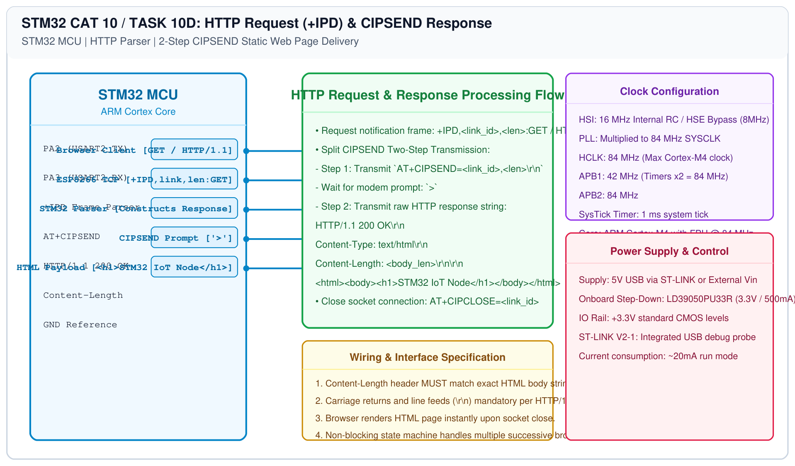

# STM32 Wi-Fi Modem – Task 10D: HTTP Request Parsing and Response Generation

## 1. Experiment Details
- **Experiment Identifier:** CONTINUOUS LAB EVALUATION-10 / 10C (Weeks 9 & 10)
- **Experiment Name:** STM32-Wemos Wi-Fi Modem Interface Using AT Commands / HTTP Server
- **Hardware Platform:** STM32 + Wemos D1 Mini (ESP8266) + Web Browser
- **Task Number:** TASK 10D — Observe HTTP Request (`+IPD`) and Construct Static HTTP Response

---

## 2. Hardware Setup and Components
| Component | Function | Description |
|---|---|---|
| STM32 Board | HTTP Web Server Logic | Processes +IPD frames and formats HTTP headers |
| ESP8266 Wemos D1 | Network Interface | Manages TCP connections and Wi-Fi transceiving |
| Client PC / Smartphone | Web Browser | Connects to `http://<ESP8266_IP>/` |

---

## 3. Circuit Diagram


---

## 4. Required Pin Connections
| STM32 Pin | Function | Wemos Pin |
|---|---|---|
| PA2 | USART2_TX | RX (GPIO3) |
| PA3 | USART2_RX | TX (GPIO1) |
| GND | Ground | GND |

---

## 5. HTTP Protocol Architecture
When an external browser navigates to the ESP8266 IP, the modem issues an asynchronous packet notification:
```text
+IPD,<link_id>,<len>:GET / HTTP/1.1
Host: 192.168.1.105
...
```

### Two-Step CIPSEND Transmission:
1. **Step 1 — Command:**
   ```c
   sprintf(cmd, "AT+CIPSEND=%d,%d\r\n", link_id, total_length);
   ```
   The ESP8266 responds with the prompt character: `>`
2. **Step 2 — HTTP Response Payload:**
   ```text
   HTTP/1.1 200 OK\r\n
   Content-Type: text/html\r\n
   Content-Length: <body_length>\r\n
   \r\n
   <html><body><h1>STM32 IoT Node</h1></body></html>
   ```
3. **Step 3 — Connection Close:**
   ```c
   sprintf(cmd, "AT+CIPCLOSE=%d\r\n", link_id);
   ```

---

## 6. Pseudocode / Code Logic
```c
char html_body[] = "<html><body><h1>STM32 IoT Node</h1><p>Hello from STM32</p></body></html>";
char http_resp[256];
char send_cmd[32];

int body_len = strlen(html_body);
sprintf(http_resp, 
        "HTTP/1.1 200 OK\r\n"
        "Content-Type: text/html\r\n"
        "Content-Length: %d\r\n"
        "\r\n"
        "%s", body_len, html_body);

int total_len = strlen(http_resp);
sprintf(send_cmd, "AT+CIPSEND=%d,%d\r\n", link_id, total_len);
send_uart2(send_cmd);
wait_for_prompt('>');
send_uart2(http_resp);
```

---

## 7. Inference / Conclusion
- Handled incoming HTTP GET requests parsed from asynchronous `+IPD` serial streams.
- Delivered compliant HTTP/1.1 200 OK web pages rendered natively in web browsers.
