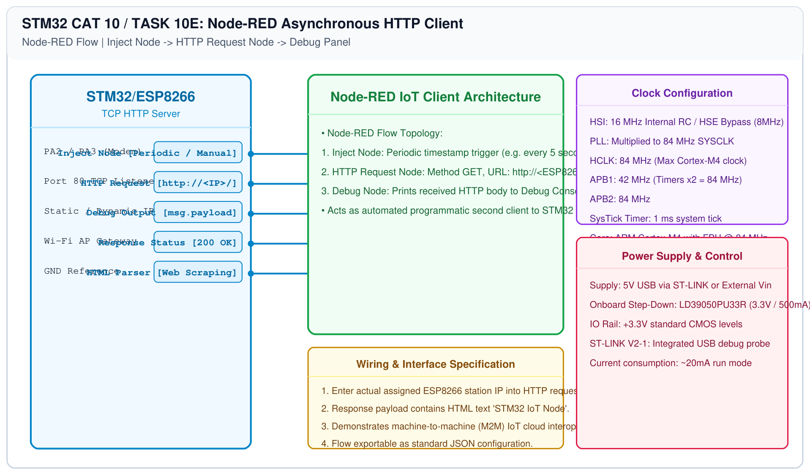

# STM32 Wi-Fi Modem – Task 10E: Node-RED HTTP Client Integration

## 1. Experiment Details
- **Experiment Identifier:** CONTINUOUS LAB EVALUATION-10 / 10C (Weeks 9 & 10)
- **Experiment Name:** STM32-Wemos Wi-Fi Modem Interface Using AT Commands / HTTP Server
- **Hardware Platform:** STM32 + Wemos D1 Mini + Node-RED Runtime (PC/Server)
- **Task Number:** TASK 10E — Node-RED as a Second HTTP Client of STM32/ESP8266 Server

---

## 2. Hardware Setup and Components
| Component | Function | Description |
|---|---|---|
| STM32 + ESP8266 | Embedded HTTP Server | Listens on port 80 and returns HTTP web responses |
| Node-RED Runtime | Automated Client | Low-code IoT integration flow running on localhost:1880 |

---

## 3. Circuit Diagram


---

## 4. Required Pin Connections
| STM32 Signal | Wemos ESP8266 | Network Route |
|---|---|---|
| PA2 (USART2_TX) | RX (GPIO3) | Wi-Fi 802.11 b/g/n wireless link to Router |
| PA3 (USART2_RX) | TX (GPIO1) | TCP socket packets over port 80 |

---

## 5. Node-RED Flow Topology
The flow consists of three core functional nodes:
1. **Inject Node (`Trigger`):** Configured to fire periodically (every 5 seconds) or on manual button click.
2. **HTTP Request Node (`GET Request`):**
   - **Method:** `GET`
   - **URL:** `http://<ESP8266_IP>/`
   - **Return:** `a UTF-8 string`
3. **Debug Node (`Debug Panel`):**
   - **Output:** `msg.payload`
   - Displays the HTTP payload received from the STM32 web server in the Node-RED debug tab.

---

## 6. Flow JSON Configuration
Import the included `nodered_http_client.json` into Node-RED:
```json
[
    {
        "id": "inject_node_1",
        "type": "inject",
        "name": "Trigger Request",
        "topic": "",
        "payload": "",
        "payloadType": "date",
        "repeat": "5",
        "crontab": "",
        "once": true,
        "onceDelay": 0.1,
        "x": 150,
        "y": 120,
        "wires": [["http_request_node_1"]]
    },
    {
        "id": "http_request_node_1",
        "type": "http request",
        "name": "STM32 Web Server",
        "method": "GET",
        "ret": "txt",
        "paytoqs": "ignore",
        "url": "http://192.168.1.105/",
        "tls": "",
        "persist": false,
        "proxy": "",
        "insecureHTTPParser": false,
        "authType": "",
        "senderr": false,
        "headers": [],
        "x": 380,
        "y": 120,
        "wires": [["debug_node_1"]]
    },
    {
        "id": "debug_node_1",
        "type": "debug",
        "name": "HTTP Payload",
        "active": true,
        "tosidebar": true,
        "console": false,
        "tostatus": false,
        "complete": "payload",
        "targetType": "msg",
        "statusVal": "",
        "statusType": "auto",
        "x": 610,
        "y": 120,
        "wires": []
    }
]
```

---

## 7. Inference / Conclusion
- Programmatic machine-to-machine polling of the STM32 HTTP server was demonstrated using Node-RED.
- The Node-RED debug panel reliably captured the HTML string responses returned by the STM32 firmware.
