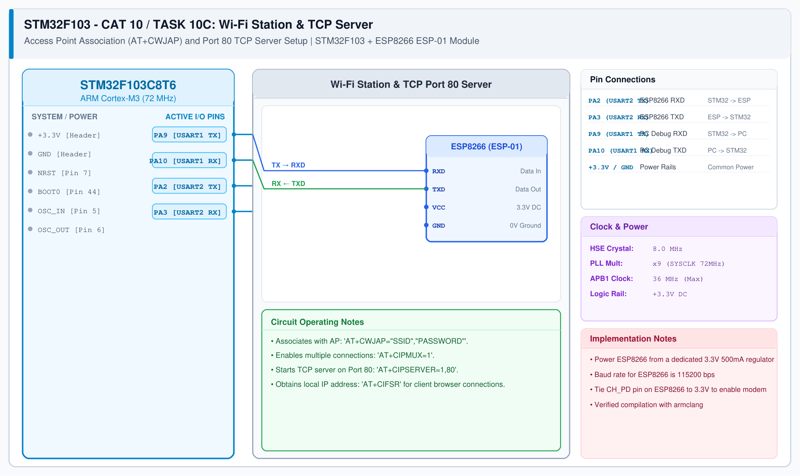

# CAT 11 - Task 11A: ESP8266 TCP Server Configuration

## 1. Experiment Name
**ESP8266 Multi-Connection Mode & Port 80 TCP Server Setup**

## 2. Hardware Setup and Components
- 1x STM32 Blue Pill Board (STM32F103C8T6)
- 1x ESP8266 Wi-Fi Module (Wemos D1 Mini / ESP-01)
- 1x Dedicated 3.3V Power Supply
- Host PC / USB-TTL Adapter for debug console

## 3. Circuit Diagram

## 4. Required Pin Connections
| STM32 Pin | Connected To | Function |
|---|---|---|
| PA2 (USART2 TX) | ESP8266 RXD | Send AT commands |
| PA3 (USART2 RX) | ESP8266 TXD | Receive AT responses |
| PA9 (USART1 TX) | USB-TTL RXD | Serial debug monitor |
| PA10 (USART1 RX) | USB-TTL TXD | Serial debug input |
| 3.3V / GND | Power Source | Power rails |

## 5. Clock Configuration
- System Clock: **72 MHz**
- Serial Baud Rate: **115200 bps**

## 6. Pseudocode / Code Logic
1. Initialize USART1 (debug) and USART2 (modem) at 115200 baud.
2. Confirm modem communication: `AT` -> `OK`.
3. Set Station mode: `AT+CWMODE=1`.
4. Connect to Wi-Fi network: `AT+CWJAP="SSID","PASSWORD"`.
5. Check allocated IP address: `AT+CIFSR`.
6. Configure multi-connection mode: `AT+CIPMUX=1`.
7. Start TCP server on port 80: `AT+CIPSERVER=1,80`.

## 7. Inference / Conclusion
- ESP8266 modem successfully establishes Station connection and opens TCP socket listening on port 80.
- Multi-client mode allows simultaneous browser connections without port conflicts.
