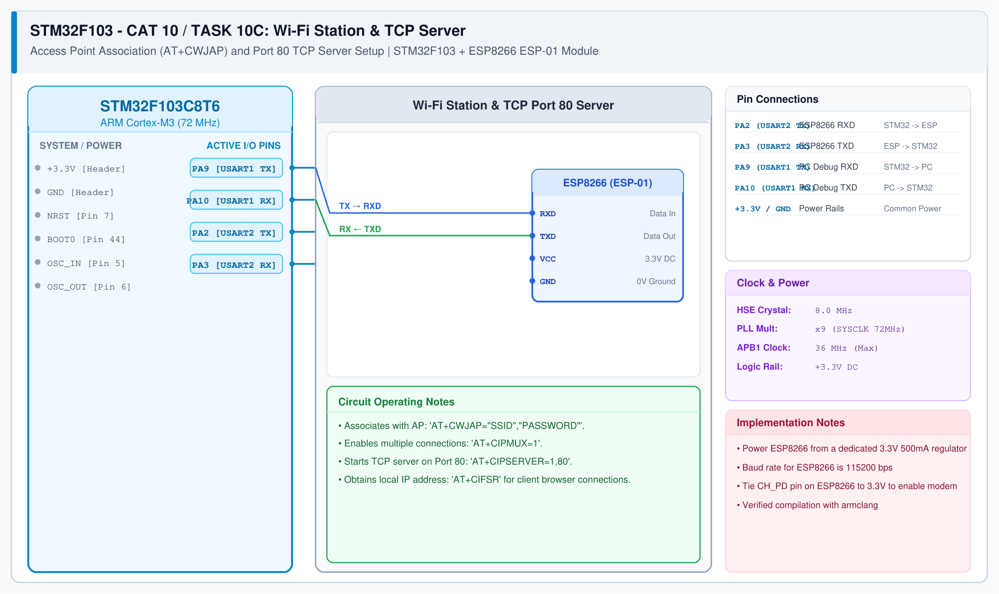

# CAT 11 - Task 11B: HTTP Web Server Response & Node-RED Client

## 1. Experiment Name
**STM32 HTTP Response Generation & Node-RED HTTP Client Ingestion**

## 2. Hardware Setup and Components
- 1x STM32 Blue Pill Board (STM32F103C8T6)
- 1x ESP8266 Wi-Fi Module (Wemos D1 Mini / ESP-01)
- 1x Dedicated 3.3V Power Supply
- Host PC running Node-RED / Web Browser

## 3. Circuit Diagram


## 4. Required Pin Connections
| STM32 Pin | Connected To | Function |
|---|---|---|
| PA2 (USART2 TX) | ESP8266 RXD | Transmit HTTP headers & HTML body |
| PA3 (USART2 RX) | ESP8266 TXD | Receive +IPD request notification |
| PA9 (USART1 TX) | USB-TTL RXD | Serial debug monitor |
| PA10 (USART1 RX) | USB-TTL TXD | Serial debug input |
| 3.3V / GND | Power Source | Power rails |

## 5. Clock Configuration
- System Clock: **72 MHz**
- Serial Baud Rate: **115200 bps**

## 6. Pseudocode / Code Logic
1. Continuous polling of USART2 for incoming client requests: `+IPD,<link_id>,<len>:GET / HTTP/1.1`.
2. Extract link ID from incoming frame.
3. Transmit HTTP response in two steps:
   - Command step: `AT+CIPSEND=<link_id>,<data_length>`.
   - Payload step upon receiving `>` prompt:
     ```
     HTTP/1.1 200 OK\r\n
     Content-Type: text/html\r\n
     Content-Length: ...\r\n\r\n
     <html><body><h1>STM32 IoT Node</h1></body></html>
     ```
4. Close socket connection: `AT+CIPCLOSE=<link_id>`.
5. Import `nodered_http_client.json` to configure an automated HTTP polling client flow in Node-RED.

## 7. Inference / Conclusion
- Both desktop web browsers and Node-RED `http request` nodes successfully fetch and parse the HTML status response.
