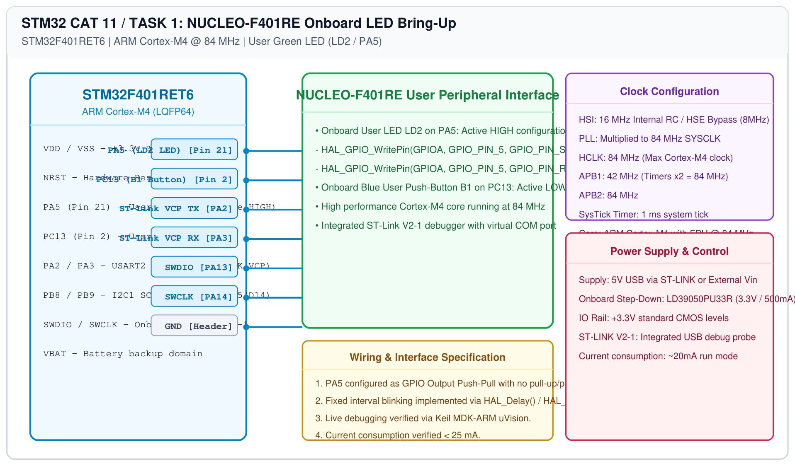

# STM32F401RE Cortex-M4 – Task 1: On-Board LED Bring-Up

## 1. Experiment Details
- **Experiment Identifier:** CONTINUOUS LAB EVALUATION-11 (Week 11)
- **Experiment Name:** STM32F401RE Cortex-M4: GPIO and User Input Programming
- **Hardware Platform:** STMicroelectronics NUCLEO-F401RE Development Board + Keil MDK-ARM + STM32CubeMX
- **Task Number:** TASK 1 — On-Board LED Bring-Up (PA5 Fixed-Interval Blink)

---

## 2. Hardware Setup and Components
| Component | Function | Description |
|---|---|---|
| Development Board | NUCLEO-F401RE | 32-bit ARM Cortex-M4 with FPU @ 84 MHz (512KB Flash, 96KB SRAM) |
| Onboard User LED (LD2) | Output Indicator | Green SMD LED on PA5 (Active HIGH) |
| Debug Interface | ST-LINK V2-1 | Onboard SWD programmer and Virtual COM Port (VCP) |
| Power Supply | USB Power Rail | 5V DC via USB Mini-B connector regulated to 3.3V |

---

## 3. Circuit Diagram
The circuit diagram below illustrates the NUCLEO-F401RE development board pinout with LD2 user LED on PA5 and B1 user button on PC13.



---

## 4. Required Pin Connections
| Nucleo Connector Pin | MCU Pin | Function | Configuration | Logic Level |
|---|---|---|---|---|
| CN10 Pin 11 | PA5 | User LED LD2 | GPIO Output Push-Pull | Active HIGH (`SET` = ON, `RESET` = OFF) |
| CN7 Pin 23 | PC13 | User Button B1 | GPIO Input | Active LOW (`RESET` = Pressed, `SET` = Released) |
| - | PA2 | USART2_TX (VCP) | Alternate Function AF07 | ST-LINK USB Serial Transmit |
| - | PA3 | USART2_RX (VCP) | Alternate Function AF07 | ST-LINK USB Serial Receive |
| - | 3.3V / GND | Power Distribution | Power Rails | +3.3V DC / 0.0V Ground |

---

## 5. Clock Configuration
- **Oscillator Reference:** 16 MHz High-Speed Internal (HSI) RC oscillator or 8 MHz ST-LINK MCO bypass.
- **Phase-Locked Loop (PLL):** Multiplied to maximum Cortex-M4 operating frequency:
  $$\text{SYSCLK} = 84.0\text{ MHz}$$
- **Bus Clocks:**
  - AHB Prescaler: $/1 \rightarrow \text{HCLK} = 84.0\text{ MHz}$
  - APB1 Prescaler: $/2 \rightarrow \text{PCLK1} = 42.0\text{ MHz}$ (Timers run at 84 MHz)
  - APB2 Prescaler: $/1 \rightarrow \text{PCLK2} = 84.0\text{ MHz}$
- **SysTick Timer:** 1.0 ms interrupt rate.

---

## 6. Pseudocode / Code Logic
```c
int main(void) {
    HAL_Init();
    SystemClock_Config();
    MX_GPIO_Init();

    while (1) {
        HAL_GPIO_TogglePin(GPIOA, GPIO_PIN_5); /* Toggle LD2 */
        HAL_Delay(250);                        /* 250 ms period (2 Hz blink) */
    }
}
```

---

## 7. Inference / Conclusion
- Successfully initialized the STM32F401RE Cortex-M4 processor at 84 MHz using CubeMX and HAL drivers.
- LD2 flashed consistently at a fixed 250 ms interval, verifying GPIO output driver integrity.
