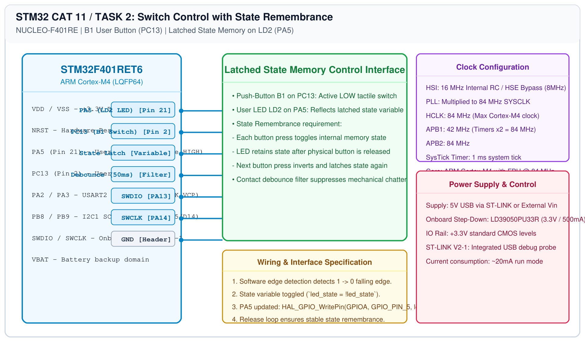

# STM32F401RE Cortex-M4 – Task 2: Switch State Remembrance

## 1. Experiment Details
- **Experiment Identifier:** CONTINUOUS LAB EVALUATION-11 (Week 11)
- **Experiment Name:** STM32F401RE Cortex-M4: GPIO and User Input Programming
- **Hardware Platform:** NUCLEO-F401RE
- **Task Number:** TASK 2 — On-Board Switch Control with State Remembrance

---

## 2. Hardware Setup and Components
| Component | Function | Description |
|---|---|---|
| NUCLEO-F401RE | MCU | Cortex-M4 running at 84 MHz |
| Blue User Switch B1 | Input Device | Connected to PC13 (Active LOW) |
| Green User LED LD2 | Latched Output | Connected to PA5 (Active HIGH) |

---

## 3. Circuit Diagram


---

## 4. Required Pin Connections
| Nucleo Signal | Port Pin | Hardware Connection | Direction |
|---|---|---|---|
| LD2 LED | PA5 | User Green LED | Digital Output Push-Pull |
| B1 Switch | PC13 | User Blue Push-Button | Digital Input (Active LOW) |

---

## 5. Clock Configuration
- **SYSCLK:** 84.0 MHz (PLL from HSI).
- **Timebase:** `HAL_GetTick()` 1 ms.

---

## 6. Pseudocode / Code Logic
### State Remembrance Logic:
When the user presses B1, the LED state toggles and remains latched in that state after release.

```c
uint8_t led_state = 0;
uint8_t last_btn = GPIO_PIN_SET;

while (1) {
    uint8_t current_btn = HAL_GPIO_ReadPin(GPIOC, GPIO_PIN_13);

    /* Falling edge detection */
    if (last_btn == GPIO_PIN_SET && current_btn == GPIO_PIN_RESET) {
        HAL_Delay(50); /* Debounce */
        if (HAL_GPIO_ReadPin(GPIOC, GPIO_PIN_13) == GPIO_PIN_RESET) {
            led_state = !led_state; /* Toggle state memory */
            HAL_GPIO_WritePin(GPIOA, GPIO_PIN_5, led_state ? GPIO_PIN_SET : GPIO_PIN_RESET);

            /* Wait for button release */
            while (HAL_GPIO_ReadPin(GPIOC, GPIO_PIN_13) == GPIO_PIN_RESET);
            HAL_Delay(20);
        }
    }
    last_btn = current_btn;
}
```

---

## 7. Inference / Conclusion
- Verified state memory retention on the NUCLEO-F401RE platform.
- Releasing the push button maintained the illuminated or extinguished LED state indefinitely until the next physical press event.
