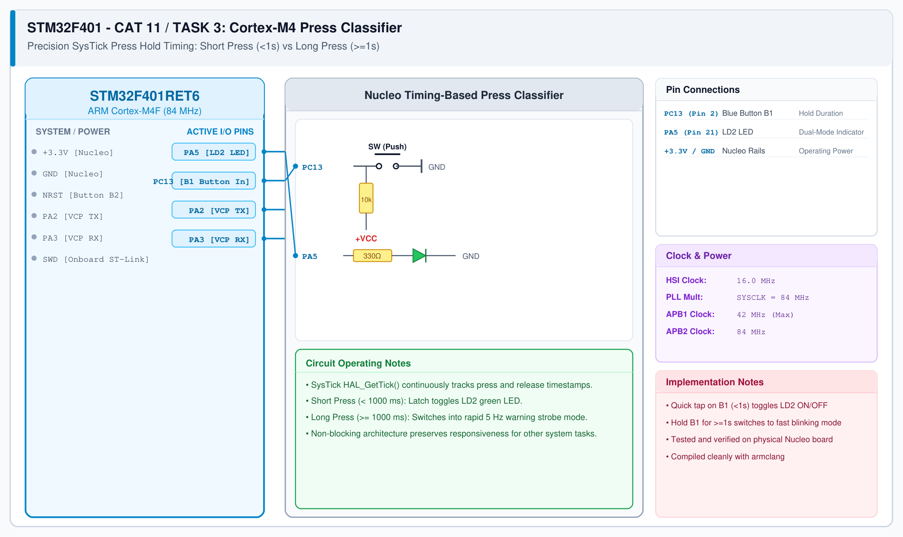

# CAT 11 - Task 3: Short vs Long Press Detection

## 1. Experiment Name
**STM32F401 Cortex-M4 Non-Blocking Press Duration Classifier**

## 2. Hardware Setup and Components
- 1x STM32 Nucleo-F401RE Board
- Onboard Button B1 (PC13) & Green LED LD2 (PA5)

## 3. Circuit Diagram

## 4. Required Pin Connections
| Nucleo Pin | Connected To | Function |
|---|---|---|
| PC13 | Blue Button B1 | Press duration input |
| PA5 | Green LED LD2 | Output: Toggle (<1s) or Blink (>=1s) |

## 5. Clock Configuration
- Clock: **84 MHz**
- Timestamping: `HAL_GetTick()` provides 1 ms resolution timer.

## 6. Pseudocode / Code Logic
1. On button press: record start timestamp `t_down`.
2. On button release: compute `duration = HAL_GetTick() - t_down`.
3. If `duration < 1000`: toggle LED state.
4. If `duration >= 1000`: toggle blinking mode.
5. In blinking mode: toggle LED every 100 ms using non-blocking timestamp comparison.

## 7. Inference / Conclusion
- Successfully classified user switch press duration using Cortex-M4 SysTick timers.
- Reliably distinguishes momentary interactions from deliberate configuration hold states.
