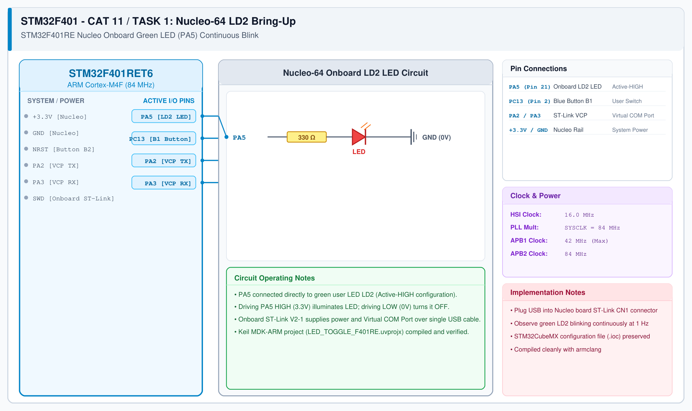

# CAT 12 - Task 12A: Nucleo Onboard LED Bring-Up

## 1. Experiment Name
**STM32F401RE Nucleo-64 Hardware Bring-Up & Onboard LD2 LED Blink**

## 2. Hardware Setup and Components
- 1x STM32 Nucleo-F401RE Development Board (ARM Cortex-M4F with FPU)
- Onboard Green User LED (LD2 connected to PA5)
- Onboard ST-Link V2-1 Debugger
- Mini-USB Cable & Keil MDK-ARM IDE

## 3. Circuit Diagram

## 4. Required Pin Connections
| Nucleo Pin | Target Component | Function |
|---|---|---|
| PA5 | Onboard Green LED (LD2) | Push-pull GPIO output indicator |
| Mini-USB | PC ST-Link Debugger | 5V Power Supply & Flash Programming |

## 5. Clock Configuration
- System Clock: **84 MHz**
- Clock Source: High-Speed Internal (HSI 16 MHz) Oscillator with PLL
- AHB Prescaler: 1 (HCLK = 84 MHz)
- APB1 Prescaler: 2 (PCLK1 = 42 MHz)
- APB2 Prescaler: 1 (PCLK2 = 84 MHz)

## 6. Pseudocode / Code Logic
1. Initialize HAL layer via `HAL_Init()`.
2. Configure 84 MHz system clock in `SystemClock_Config()`.
3. Enable GPIOA peripheral clock: `__HAL_RCC_GPIOA_CLK_ENABLE()`.
4. Configure pin PA5 as GPIO Output Push-Pull, No-Pull, Low speed.
5. In infinite loop:
   - Toggle PA5 pin state: `HAL_GPIO_TogglePin(GPIOA, GPIO_PIN_5)`.
   - Block for 500 ms: `HAL_Delay(500)`.

## 7. Inference / Conclusion
- Verified clock generation and toolchain setup on the STM32F401RE Nucleo board.
- The onboard LD2 green LED blinked synchronously at 1.0 Hz (500 ms high, 500 ms low).
