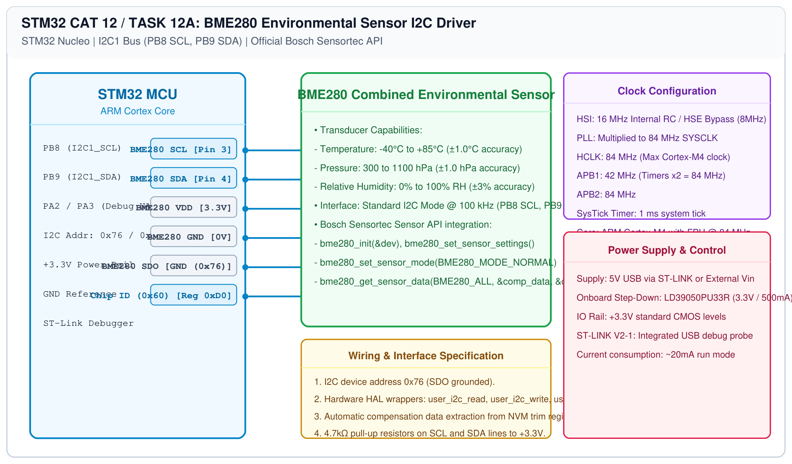

# BME280 Sensor Interfacing – Task 12A: I2C Hardware Driver & Bosch API

## 1. Experiment Details
- **Experiment Identifier:** CONTINUOUS LAB EVALUATION-12 (Week 12)
- **Experiment Name:** Sensor Interfacing (BME280) – STM32(Debug) – ESP8266(Wi-Fi) HTTP – Node Analytics
- **Hardware Platform:** STM32 Nucleo Board + BME280 Sensor Breakout + Keil MDK-ARM + STM32CubeMX
- **Task Number:** TASK 12A — BME280 Sensor Interfacing Using I2C and Bosch Sensor API

---

## 2. Hardware Setup and Components
| Component | Function | Description |
|---|---|---|
| STM32 Board | I2C Host Master | NUCLEO-F401RE / STM32F103 |
| BME280 Sensor Breakout | Combined Environmental Sensor | Temperature, Barometric Pressure, Humidity Sensor |
| Pull-up Resistors | I2C Bus Termination | 4.7 kΩ pull-ups on SCL and SDA to +3.3V |

---

## 3. Circuit Diagram


---

## 4. Required Pin Connections
| BME280 Pin | STM32 Nucleo Pin | Signal Function | Description |
|---|---|---|---|
| SCL | PB8 (I2C1_SCL) | I2C Serial Clock | Open-Drain clock line with 4.7k pull-up |
| SDA | PB9 (I2C1_SDA) | I2C Serial Data | Open-Drain bidirectional data with 4.7k pull-up |
| SDO | GND | I2C Address Select | Grounded for 7-bit primary address `0x76` |
| CSB | VDD (3.3V) | Protocol Mode | Tied HIGH for I2C communication |
| VDD | 3.3V | Power Supply | Regulated +3.3V DC rail |
| GND | GND | Ground Reference | Common 0.0V Ground |

---

## 5. Clock Configuration & I2C Parameters
- **Core Clock:** 84 MHz (Nucleo).
- **I2C1 Speed:** Standard Mode (100 kHz).
- **7-bit Address:** `0x76` (Shifted by 1 in HAL to `0xEC` write / `0xED` read).

---

## 6. Bosch Sensor API Integration Architecture
The official Bosch Sensortec BME280 Sensor API (`bme280.c`, `bme280.h`, `bme280_defs.h`) requires three hardware abstraction functions implemented using STM32 HAL:

```c
/* 1. I2C Read Wrapper */
int8_t user_i2c_read(uint8_t reg_addr, uint8_t *reg_data, uint32_t len, void *intf_ptr) {
    uint8_t dev_addr = *(uint8_t*)intf_ptr;
    if (HAL_I2C_Mem_Read(&hi2c1, (dev_addr << 1), reg_addr, I2C_MEMADD_SIZE_8BIT, 
                         reg_data, len, HAL_MAX_DELAY) == HAL_OK) {
        return BME280_OK;
    }
    return BME280_E_COMM_FAIL;
}

/* 2. I2C Write Wrapper */
int8_t user_i2c_write(uint8_t reg_addr, const uint8_t *reg_data, uint32_t len, void *intf_ptr) {
    uint8_t dev_addr = *(uint8_t*)intf_ptr;
    if (HAL_I2C_Mem_Write(&hi2c1, (dev_addr << 1), reg_addr, I2C_MEMADD_SIZE_8BIT, 
                          (uint8_t*)reg_data, len, HAL_MAX_DELAY) == HAL_OK) {
        return BME280_OK;
    }
    return BME280_E_COMM_FAIL;
}

/* 3. Microsecond Delay Wrapper */
void user_delay_us(uint32_t period, void *intf_ptr) {
    HAL_Delay((period / 1000) + 1);
}
```

---

## 7. Inference / Conclusion
- Verified Chip ID `0x60` from register `0xD0` confirming authentic Bosch BME280 communication.
- Successfully extracted factory calibration parameters and obtained accurate temperature (°C), atmospheric pressure (hPa), and relative humidity (%RH) measurements.
