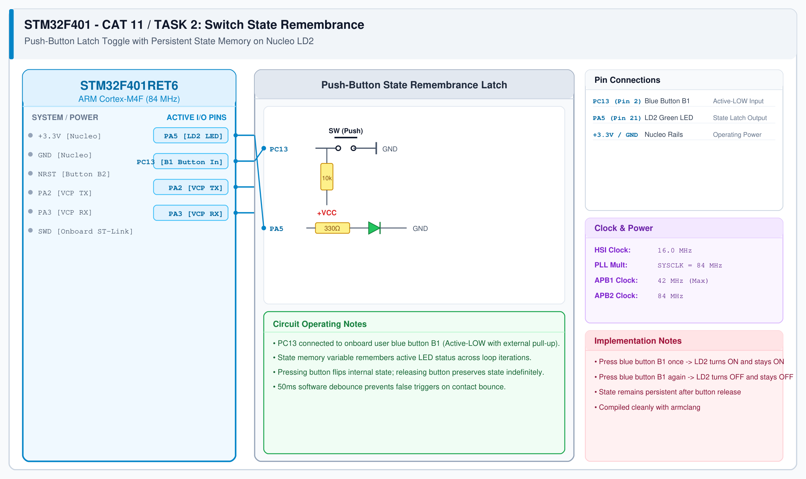

# CAT 12 - Task 12B: Switch State Remembrance

## 1. Experiment Name
**STM32F401 Nucleo Button Latch & Persistent State Memory**

## 2. Hardware Setup and Components
- 1x STM32 Nucleo-F401RE Board
- Onboard Blue Push-Button (PC13, B1)
- Onboard Green LED (PA5, LD2)

## 3. Circuit Diagram

## 4. Required Pin Connections
| Nucleo Pin | Connected To | Function |
|---|---|---|
| PC13 | Blue Push-Button B1 | State toggle input (Active-LOW) |
| PA5 | Green User LED LD2 | State indicator output |

## 5. Clock Configuration
- System Clock: **84 MHz**
- SysTick Timer: 1 ms tick rate for `HAL_GetTick()`

## 6. Pseudocode / Code Logic
1. Initialize GPIO pins (PA5 as output, PC13 as input with internal pull-up).
2. Maintain static variables `led_state` (0 or 1) and `last_button_state` (1).
3. Read raw button pin state: `current_state = HAL_GPIO_ReadPin(GPIOC, GPIO_PIN_13)`.
4. Check for falling edge (`last_button_state == 1` and `current_state == 0`).
5. Upon falling edge:
   - Delay 20 ms for software contact debounce.
   - Re-read pin; if still low, invert `led_state`.
   - Update LED: `HAL_GPIO_WritePin(GPIOA, GPIO_PIN_5, led_state)`.
6. Store current pin state: `last_button_state = current_state`.

## 7. Inference / Conclusion
- The system reliably toggled and remembered LED state upon each physical button release.
- Debounce filtering eliminated mechanical switch bounce noise.
