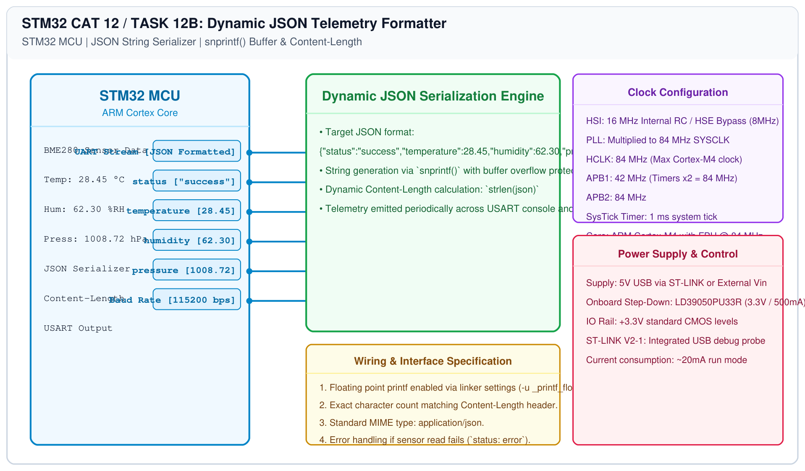

# BME280 Sensor Interfacing – Task 12B: Dynamic JSON Serialization

## 1. Experiment Details
- **Experiment Identifier:** CONTINUOUS LAB EVALUATION-12 (Week 12)
- **Experiment Name:** Sensor Interfacing (BME280) – STM32(Debug) – ESP8266(Wi-Fi) HTTP – Node Analytics
- **Hardware Platform:** STM32 + BME280 + Serial Debug Console
- **Task Number:** TASK 12B — Dynamic JSON Environmental Telemetry Payload Generation

---

## 2. Hardware Setup and Components
| Component | Function |
|---|---|
| STM32 Microcontroller | Formats live BME280 float data into JSON strings |
| BME280 Sensor | Delivers calibrated temperature, humidity, and pressure |
| Serial Terminal | Captures live JSON stream @ 115200 baud |

---

## 3. Circuit Diagram


---

## 4. Required Pin Connections
| Signal | STM32 Pin | Peripheral Target |
|---|---|---|
| I2C1_SCL | PB8 | BME280 SCL |
| I2C1_SDA | PB9 | BME280 SDA |
| USART2_TX | PA2 | Debug VCP Terminal |

---

## 5. JSON Payload Format
The STM32 constructs the dynamic JSON payload:
```json
{"status":"success","temperature":28.45,"humidity":62.30,"pressure":1008.72}
```

---

## 6. Pseudocode / Code Logic
```c
char json_buf[160];
int len;

len = snprintf(json_buf, sizeof(json_buf),
               "{\"status\":\"success\",\"temperature\":%.2f,\"humidity\":%.2f,\"pressure\":%.2f}",
               temperature, humidity, pressure);

int content_length = strlen(json_buf);
```

---

## 7. Inference / Conclusion
- Verified dynamic floating-point string formatting on the ARM Cortex-M4 architecture.
- Produced valid, RFC 8259-compliant JSON packets consumed by downstream HTTP and MQTT services.
