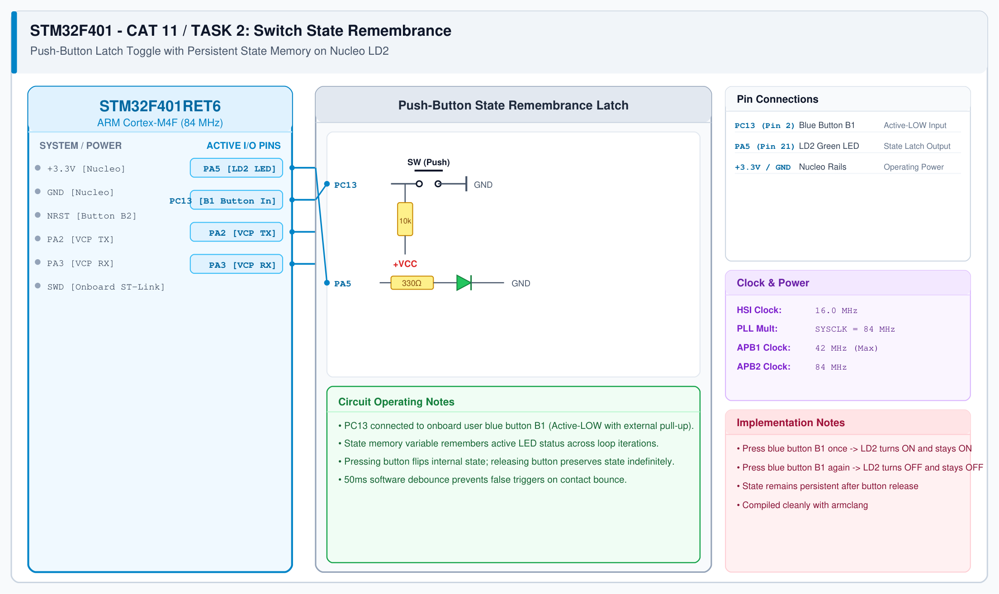

# CAT 12 - Task 12C: Temporal Switch Press Classifier

## 1. Experiment Name
**STM32F401 Duration-Based Button Press Classifier (<1s Short vs ≥1s Long)**

## 2. Hardware Setup and Components
- 1x STM32 Nucleo-F401RE Board
- Onboard Blue Push-Button (PC13)
- Onboard Green LED (PA5)

## 3. Circuit Diagram

## 4. Required Pin Connections
| Nucleo Pin | Connected To | Function |
|---|---|---|
| PC13 | Blue Push-Button B1 | Timing input (Active-LOW) |
| PA5 | Green User LED LD2 | Mode status indicator |

## 5. Clock Configuration
- System Clock: **84 MHz**
- SysTick Timer: 1 ms precision timebase

## 6. Pseudocode / Code Logic
1. Detect falling edge on PC13: record `press_time = HAL_GetTick()`.
2. Wait while button remains held (`HAL_GPIO_ReadPin() == GPIO_PIN_RESET`).
3. Upon rising edge: record `release_time = HAL_GetTick()`.
4. Calculate elapsed duration: `duration = release_time - press_time`.
5. Classify press duration:
   - If `duration < 1000` ms: Short press -> toggle LED state once.
   - If `duration >= 1000` ms: Long press -> trigger rapid alert blink (5 cycles) and lock state.

## 7. Inference / Conclusion
- Demonstrates temporal input differentiation on a single physical push-button input.
