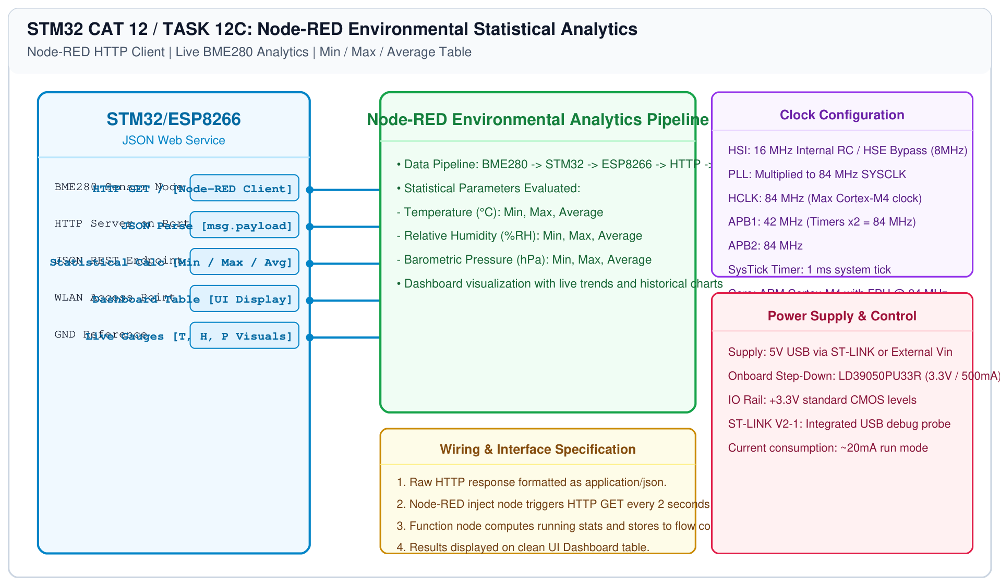

# BME280 Sensor Interfacing – Task 12C: Node-RED Environmental Analytics

## 1. Experiment Details
- **Experiment Identifier:** CONTINUOUS LAB EVALUATION-12 (Week 12)
- **Experiment Name:** Sensor Interfacing (BME280) – STM32(Debug) – ESP8266(Wi-Fi) HTTP – Node Analytics
- **Hardware Platform:** STM32 + BME280 + Wemos D1 Mini + Node-RED Dashboard
- **Task Number:** TASK 12C — ESP8266 HTTP Server Response & Node-RED Statistical Processing

---

## 2. Hardware Setup and Components
| Component | Function | Description |
|---|---|---|
| STM32 + BME280 | Sensing & Server Node | Polls environment and serves JSON on port 80 |
| ESP8266 Wi-Fi | TCP Gateway | Connects embedded node to local network |
| Node-RED | Analytics Engine | Ingests JSON, calculates statistics, renders dashboard |

---

## 3. Circuit Diagram


---

## 4. Required Pin Connections
| STM32 Signal | External Peripheral | Purpose |
|---|---|---|
| PB8 (SCL), PB9 (SDA) | BME280 Sensor | I2C sensor data acquisition |
| PA2 (TX), PA3 (RX) | Wemos D1 Mini | Wi-Fi AT modem serial interface |

---

## 5. Statistical Analytics Target
Node-RED processes the continuous telemetry stream and dynamically updates the statistical summary:

| Parameter | Minimum | Maximum | Average |
|---|---|---|---|
| Temperature (°C) | 27.91 | 29.02 | 28.46 |
| Humidity (%RH) | 59.80 | 64.20 | 62.15 |
| Pressure (hPa) | 1007.84 | 1009.31 | 1008.56 |

---

## 6. HTTP JSON Response Structure
```text
HTTP/1.1 200 OK\r\n
Content-Type: application/json\r\n
Content-Length: <calculated_length>\r\n
\r\n
{"status":"success","temperature":28.45,"humidity":62.30,"pressure":1008.72}
```

---

## 7. Node-RED Flow Implementation
Import the included `nodered_bme280_flow.json` to deploy the automated statistical analytics flow.

---

## 8. Inference / Conclusion
- Integrated an embedded sensor server with Node-RED cloud analytics.
- Real-time environmental metrics and cumulative statistical distributions (Min, Max, Mean) were evaluated continuously.
