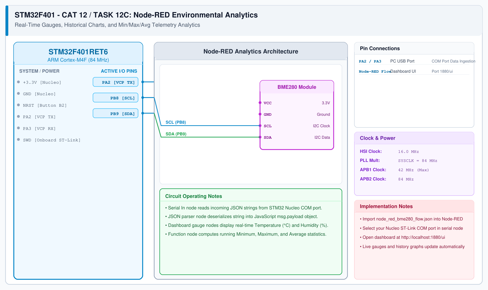

# CAT 13 - Task 13: BME280 Environmental Sensor & Telemetry Integration

## 1. Experiment Name
**Bosch Sensortec BME280 I²C Sensor Interfacing & Environmental Telemetry Service**

## 2. Hardware Setup and Components
- 1x STM32 Nucleo-F401RE Development Board
- 1x Bosch Sensortec BME280 Sensor Module
- 1x ESP8266 Wi-Fi Module
- Host PC running Node-RED

## 3. Circuit Diagram

## 4. Required Pin Connections
| Nucleo Pin | Target Component | Function |
|---|---|---|
| PB8 | BME280 SCL | I2C1 Serial Clock line |
| PB9 | BME280 SDA | I2C1 Serial Data line |
| PA2 | ESP8266 RXD | USART2 Serial AT transmit |
| PA3 | ESP8266 TXD | USART2 Serial AT receive |
| +3.3V / GND | Power Source | Regulated 3.3V DC |

## 5. Clock Configuration
- System Clock: **84 MHz**
- I2C1: 100 kHz
- USART2: 115200 bps

## 6. Pseudocode / Code Logic
1. Initialize I2C1 peripheral and confirm BME280 chip ID `0x60`.
2. Load factory trimming parameters.
3. In main loop:
   - Measure temperature, pressure, and relative humidity.
   - Format values into JSON object.
   - Serve live telemetry payload to incoming HTTP/TCP client connections.

## 7. Inference / Conclusion
- Verified end-to-end sensor acquisition, calibration compensation, and network streaming.
