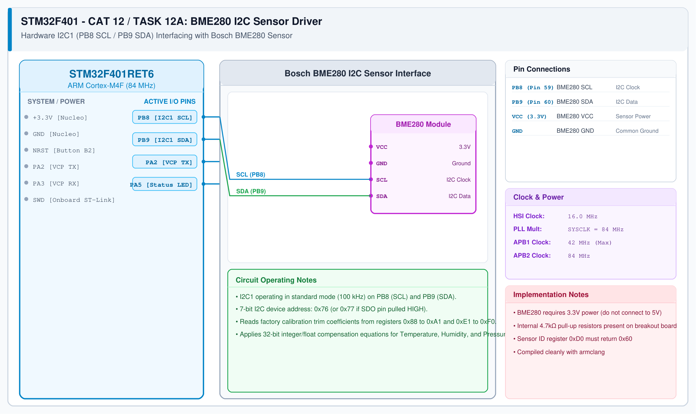

# CAT 13 - Task 13A: MQTT Broker Connection

## 1. Experiment Name
**STM32 & ESP8266 Cloud MQTT Handshake & Connection Setup**

## 2. Hardware Setup and Components
- 1x STM32 Nucleo-F401RE Board
- 1x ESP8266 Wi-Fi Module (Wemos D1 Mini / ESP-01)
- 1x 3.3V Power Regulator
- Wi-Fi Router with Internet Access
- Public MQTT Broker: `broker.emqx.io` (Port 1883)

## 3. Circuit Diagram


## 4. Required Pin Connections
| Nucleo Pin | Target Pin | Function |
|---|---|---|
| PA2 (USART2 TX) | ESP8266 RXD | Send AT & MQTT packets |
| PA3 (USART2 RX) | ESP8266 TXD | Receive responses |
| PA5 | Onboard LD2 LED | Status indicator |
| 3.3V / GND | Power Source | Module power |

## 5. Clock Configuration
- System Clock: **84 MHz**
- USART2: **115200 bps**
- Keep-Alive Interval: **60 seconds**

## 6. Pseudocode / Code Logic
1. Initialize the Wi-Fi module in Station mode: `ESP8266_Init(StationMode, huart2)`.
2. Connect to the local Wi-Fi router: `ESP8266_wifiConnect("SSID", "PASSWORD")`.
3. Open a TCP socket to the broker: `ESP8266_portConnect("TCP", "broker.emqx.io", "1883")`.
4. Configure client parameters:
   ```c
   MQTT_InitTypeDef_t mqttSetting;
   mqttSetting.keepAlive = 60;
   mqttSetting.connectFlag = CleanSession;
   mqttSetting.clientID = "suryajith_stm32_node";
   ```
5. Transmit the MQTT CONNECT packet: `MQTT_connectBroker(&mqttSetting)`.
6. Confirm receipt of CONNACK (`0x20, 0x02, 0x00, 0x00`).

## 7. Inference / Conclusion
- Successfully connected the STM32 to the public EMQX cloud broker over TCP port 1883.
- Received a valid CONNACK packet, confirming the client session was established.
