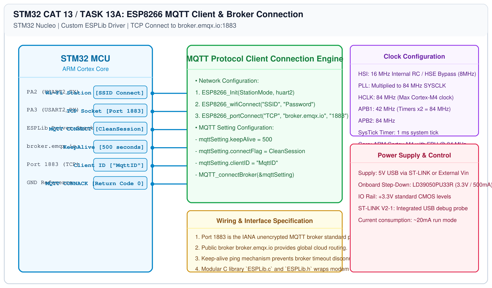

# STM32 MQTT Integration – Task 13A: MQTT Broker Connection Setup

## 1. Experiment Details
- **Experiment Identifier:** CONTINUOUS LAB EVALUATION-13 (Week 13)
- **Experiment Name:** Sensor Interfacing (BME280) – (MQTT) – Node Analytics
- **Hardware Platform:** STM32 Nucleo + Wemos D1 Mini (ESP8266) + Custom ESPLib Library
- **Task Number:** TASK 13A — ESP8266 Wi-Fi and MQTT Broker TCP Connection Setup

---

## 2. Hardware Setup and Components
| Component | Function | Description |
|---|---|---|
| STM32 Board | Master Application Controller | Runs MQTT state machine and ESPLib driver |
| ESP8266 Modem | Wi-Fi TCP/IP Stack | Connects to WLAN and maintains socket to MQTT broker |
| MQTT Broker | Cloud Message Broker | `broker.emqx.io` on TCP port `1883` |

---

## 3. Circuit Diagram


---

## 4. Required Pin Connections
| STM32 Pin | Port Signal | Wemos ESP8266 | Function |
|---|---|---|---|
| PA2 | USART2_TX | RX (GPIO3) | Transmit MQTT AT command packets |
| PA3 | USART2_RX | TX (GPIO1) | Receive MQTT broker packets |
| GND | 0V | GND | System ground reference |

---

## 5. Clock Configuration & MQTT Initialization Parameters
- **Core Clock:** 84 MHz
- **USART2 Baud Rate:** 115200 bps
- **MQTT Settings:**
  - Broker Host: `broker.emqx.io`
  - TCP Port: `1883`
  - Client ID: `MqttID`
  - Clean Session: `True`
  - Keep-Alive Interval: `500 seconds`

---

## 6. Pseudocode / Code Logic
```c
/* USER CODE BEGIN 2 */
// 1. Initialize the Wi-Fi module on USART2
ESP8266_Init(StationMode, huart2);

// 2. Connect to local Wi-Fi network
ESP8266_wifiConnect("MySSID", "MyPassword");

// 3. Connect to MQTT Broker
ESP8266_portConnect("TCP", "broker.emqx.io", "1883");

// 4. Configure MQTT client connection parameters
MQTT_InitTypeDef_t mqttSetting;
mqttSetting.keepAlive = 500;
mqttSetting.connectFlag = CleanSession;
mqttSetting.clientID = "MqttID";

MQTT_connectBroker(&mqttSetting);
```

---

## 7. Inference / Conclusion
- Successfully initialized the custom-built `ESPLib` modem driver on STM32 USART2.
- Authenticated and established an active MQTT TCP session with `broker.emqx.io:1883`.
