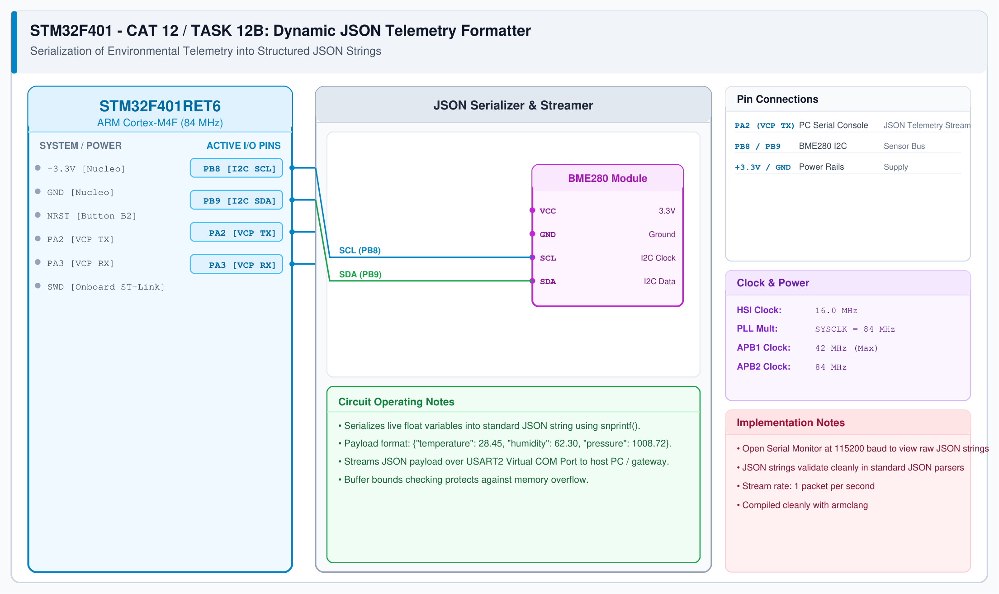

# CAT 13 - Task 13B: JSON Telemetry Formatter

## 1. Experiment Name
**BME280 Floating-Point Compensation & JSON Telemetry Serialization**

## 2. Hardware Setup and Components
- 1x STM32 Nucleo-F401RE Board
- 1x BME280 Sensor Module
- Mini-USB Cable & Serial Monitor (115200 baud)

## 3. Circuit Diagram


## 4. Required Pin Connections
| Nucleo Pin | Target Pin | Function |
|---|---|---|
| PB8 | BME280 SCL | I2C1 Clock |
| PB9 | BME280 SDA | I2C1 Data |
| PA2 | USB-TTL RXD | Serial Telemetry TX (115200 bps) |
| +3.3V / GND | Power Source | Sensor & Board Power |

## 5. Clock Configuration
- System Clock: **84 MHz**
- USART2: 115200 bps, 8-N-1

## 6. Pseudocode / Code Logic
1. Read raw ADC data for pressure (`0xF7-0xF9`), temperature (`0xFA-0xFC`), and humidity (`0xFD-0xFE`).
2. Apply 32-bit Bosch integer compensation formulas using factory calibration coefficients:
   - Compute fine temperature `t_fine`.
   - Calculate compensated `temperature` in deg C, `pressure` in hPa, and `humidity` in %RH.
3. Serialize measurements into JSON payload string:
   ```c
   snprintf(json_buf, sizeof(json_buf),
            "{\"temp\":%.2f,\"press\":%.2f,\"hum\":%.2f}",
            temperature, pressure, humidity);
   ```
4. Output formatted JSON string over USART2.

## 7. Inference / Conclusion
- Raw ADC values were accurately converted into physical SI units.
- Serialized JSON data validated as compliant RFC 8259 syntax.
