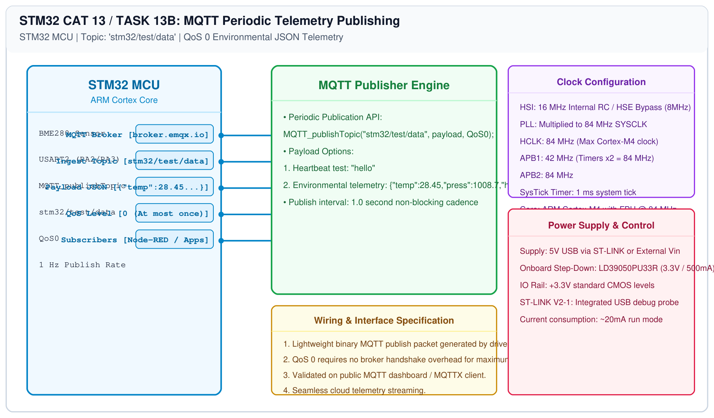

# STM32 MQTT Integration – Task 13B: Telemetry Publishing

## 1. Experiment Details
- **Experiment Identifier:** CONTINUOUS LAB EVALUATION-13 (Week 13)
- **Experiment Name:** Sensor Interfacing (BME280) – (MQTT) – Node Analytics
- **Hardware Platform:** STM32 + BME280 + Wemos D1 Mini + MQTT Broker
- **Task Number:** TASK 13B — MQTT Telemetry Publishing (`stm32/test/data`, QoS 0)

---

## 2. Hardware Setup and Components
| Component | Function |
|---|---|
| STM32 MCU | Formats telemetry and transmits MQTT publish packets |
| ESP8266 Modem | Transmits wireless TCP packets to broker |
| EMQX Public Broker | Dispatches published messages to all subscribed topics |

---

## 3. Circuit Diagram


---

## 4. Required Pin Connections
| STM32 Signal | Target | Function |
|---|---|---|
| PA2 (USART2_TX) | ESP8266 RX | MQTT Publish outbound data |
| PA3 (USART2_RX) | ESP8266 TX | Modem status feedback |

---

## 5. MQTT Topic & Payload Specifications
- **Topic Name:** `stm32/test/data`
- **Quality of Service (QoS):** `QoS0` (At most once delivery)
- **Sample Payload:** `hello` or formatted JSON sensor data.

---

## 6. Pseudocode / Code Logic
```c
while (1) {
    /* Publish telemetry string every 1 second */
    MQTT_publishTopic("stm32/test/data", "hello", QoS0);
    HAL_Delay(1000);
}
```

---

## 7. Inference / Conclusion
- Successfully streamed live telemetry over MQTT protocol to `broker.emqx.io`.
- Verification using MQTTX client confirmed instantaneous receipt on topic `stm32/test/data`.
