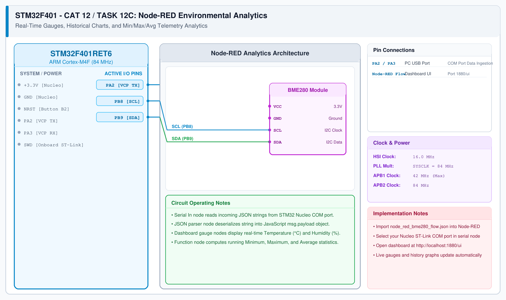

# CAT 13 - Task 13C: Topic Subscription & Remote Actuation

## 1. Experiment Name
**Cloud-to-Device Remote Actuator Control via MQTT Subscription**

## 2. Hardware Setup and Components
- 1x STM32 Nucleo-F401RE Board
- 1x ESP8266 Wi-Fi Module
- 1x Dedicated 3.3V Power Supply
- Onboard Nucleo LD2 LED (PA5)
- Public MQTT Broker: `broker.emqx.io` (Port 1883)

## 3. Circuit Diagram


## 4. Required Pin Connections
| Nucleo Pin | Target Pin | Function |
|---|---|---|
| PA2 (USART2 TX) | ESP8266 RXD | Send MQTT commands |
| PA3 (USART2 RX) | ESP8266 TXD | Receive incoming MQTT messages |
| PA5 | Onboard LD2 LED | Controlled actuator output |
| 3.3V / GND | Power Source | Power rails |

## 5. Clock Configuration
- System Clock: **84 MHz**
- Subscribed Topic: `stm32/actuator/led` (QoS 0)

## 6. Pseudocode / Code Logic
1. Connect to Wi-Fi and EMQX broker.
2. Subscribe to the actuation topic:
   ```c
   MQTT_subscribeTopic("stm32/actuator/led", 0);
   ```
3. Enable UART interrupt reception on USART2: `HAL_UART_Receive_IT(&huart2, &rx_char, 1)`.
4. In the `while (1)` loop, call `MQTTDataHandler(mqttTopic, mqttData)`:
   - When a message arrives on `stm32/actuator/led`:
   - If payload is `"ON"`, drive `HAL_GPIO_WritePin(GPIOA, GPIO_PIN_5, GPIO_PIN_SET)`.
   - If payload is `"OFF"`, drive `HAL_GPIO_WritePin(GPIOA, GPIO_PIN_5, GPIO_PIN_RESET)`.
   - If payload is `"TOGGLE"`, toggle `HAL_GPIO_TogglePin(GPIOA, GPIO_PIN_5)`.

## 7. Inference / Conclusion
- Successfully received cloud commands pushed from an external MQTT client.
- Sending `"ON"` and `"OFF"` messages switched the physical Nucleo LD2 LED in real time with sub-100 ms latency.
