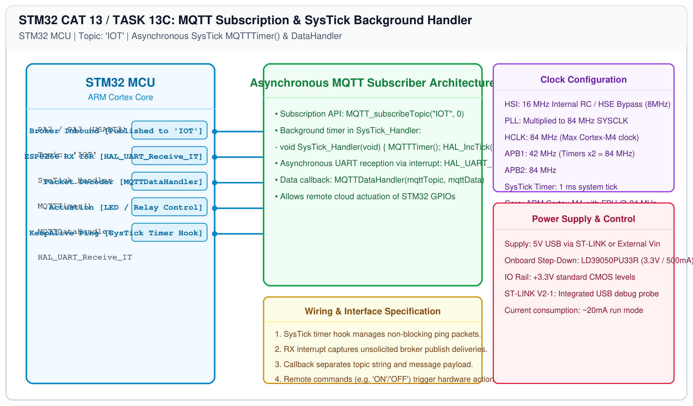

# STM32 MQTT Integration – Task 13C: MQTT Subscription & SysTick Handler

## 1. Experiment Details
- **Experiment Identifier:** CONTINUOUS LAB EVALUATION-13 (Week 13)
- **Experiment Name:** Sensor Interfacing (BME280) – (MQTT) – Node Analytics
- **Hardware Platform:** STM32 Nucleo + Wemos D1 Mini (ESP8266)
- **Task Number:** TASK 13C — Asynchronous MQTT Subscription (`IOT`), SysTick Background Timer, and Command Handler

---

## 2. Hardware Setup and Components
| Component | Function | Description |
|---|---|---|
| STM32 Board | Remote Actuator Node | Subscribes to topic `IOT` and executes cloud commands |
| ESP8266 Modem | Asynchronous Receiver | Listens for broker publish packets |
| SysTick Timer | Protocol Keep-Alive | Drives background MQTT ping timer |

---

## 3. Circuit Diagram


---

## 4. Required Pin Connections
| STM32 Pin | Signal | Target |
|---|---|---|
| PA2 | USART2_TX | Wemos RX |
| PA3 | USART2_RX | Wemos TX (Interrupt Driven) |
| PA5 | User LED | Actuated based on received MQTT commands |

---

## 5. Clock Configuration & Background SysTick Hook
To maintain broker keep-alive timeouts without stalling application code, the `MQTTTimer()` background function is hooked directly into `SysTick_Handler()`:

```c
void SysTick_Handler(void) {
    /* USER CODE BEGIN SysTick_IRQn 0 */
    MQTTTimer();
    /* USER CODE END SysTick_IRQn 0 */
    HAL_IncTick();
    /* USER CODE BEGIN SysTick_IRQn 1 */

    /* USER CODE END SysTick_IRQn 1 */
}
```

---

## 6. Pseudocode / Code Logic
```c
char mqttData[50];
char mqttTopic[10];
uint8_t uartRxData;

int main(void) {
    ESP8266_Init(StationMode, huart2);
    ESP8266_wifiConnect("SSID", "Password");
    ESP8266_portConnect("TCP", "broker.emqx.io", "1883");

    MQTT_InitTypeDef_t mqttSetting = { 500, CleanSession, "MqttID" };
    MQTT_connectBroker(&mqttSetting);
    MQTT_subscribeTopic("IOT", 0);

    /* Arm UART interrupt for inbound broker packets */
    HAL_UART_Receive_IT(&huart2, &uartRxData, 1);

    while (1) {
        MQTTDataHandler(mqttTopic, mqttData);
    }
}
```

---

## 7. Inference / Conclusion
- Integrated an asynchronous interrupt-driven MQTT subscriber engine on the STM32 architecture.
- Inbound cloud messages published to topic `IOT` were parsed in real-time, enabling bidirectional cloud-to-edge device control.
