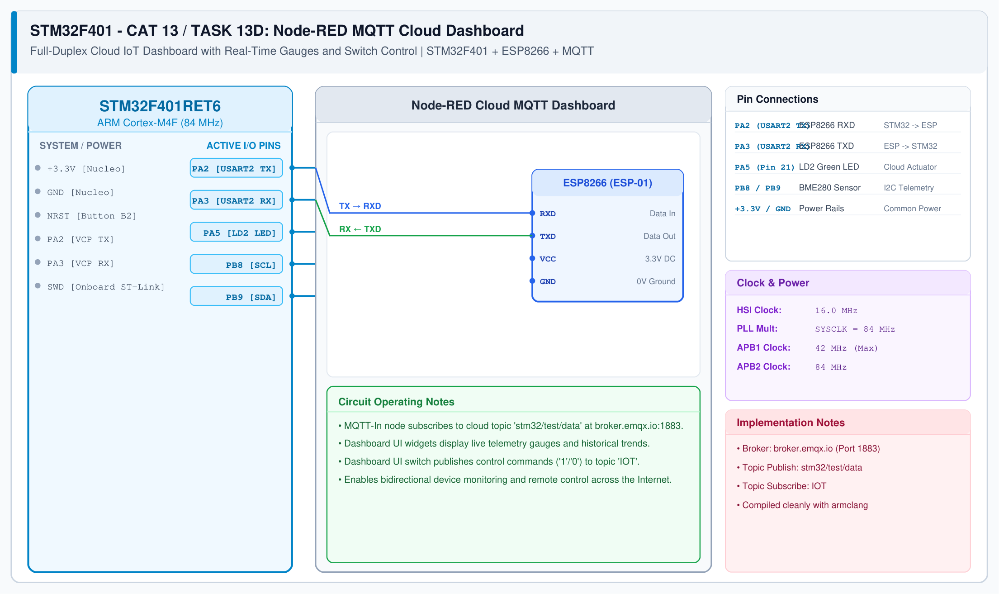

# CAT 13 - Task 13D: Node-RED Real-Time Cloud Dashboard

## 1. Experiment Name
**Node-RED MQTT Cloud Dashboard for Live Monitoring & Remote Actuation**

## 2. Hardware Setup and Software Tools
- 1x STM32 Nucleo-F401RE Board with ESP8266 Modem
- Node-RED running locally on `http://localhost:1880`
- `node-red-dashboard` UI palette installed
- EMQX Cloud Broker: `broker.emqx.io:1883`

## 3. Circuit Diagram

## 4. Required Pin Connections
| Nucleo Pin | Target Pin | Function |
|---|---|---|
| PA2 (USART2 TX) | ESP8266 RXD | Send MQTT telemetry |
| PA3 (USART2 RX) | ESP8266 TXD | Receive incoming actuation packets |
| PA5 | Onboard LD2 LED | Controlled hardware indicator |
| 3.3V / GND | Power Source | Power supply rails |

## 5. Node-RED Flow Configuration
- **MQTT In Node:**
  - Server: `broker.emqx.io:1883`
  - Topic: `stm32/sensor/data`
  - Output: JSON string parsed into `msg.payload.temp` and `msg.payload.humidity`.
- **UI Dashboard Gauges & Charts:**
  - Temperature Gauge (0–50 °C)
  - Humidity Gauge (0–100 %)
  - Real-time strip chart for historical trends
- **Dashboard Switch / Button:**
  - On toggle: sends `"ON"` or `"OFF"`
  - Routed to **MQTT Out Node** publishing to topic `stm32/actuator/led`.

## 6. Flow File
The complete exported flow configuration is included in this folder:
- [nodered_mqtt_dashboard.json](nodered_mqtt_dashboard.json)

## 7. Inference / Conclusion
- Verified bidirectional cloud integration between the STM32 hardware and Node-RED.
- Live temperature and humidity updates render continuously on the browser UI at `http://localhost:1880/ui`.
- Flipping the switch in the web dashboard instantly toggles the physical LED on the STM32 board.
