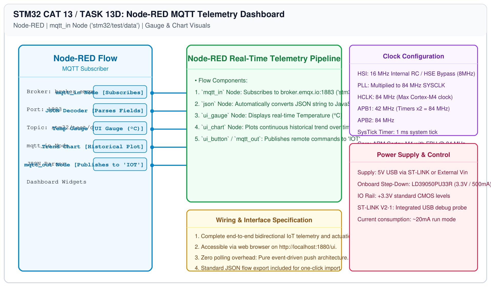

# STM32 MQTT Integration – Task 13D: Node-RED MQTT Dashboard Flow

## 1. Experiment Details
- **Experiment Identifier:** CONTINUOUS LAB EVALUATION-13 (Week 13)
- **Experiment Name:** Sensor Interfacing (BME280) – (MQTT) – Node Analytics
- **Hardware Platform:** Node-RED Runtime + MQTT Broker (`broker.emqx.io`) + STM32 Sensor Node
- **Task Number:** TASK 13D — Node-RED MQTT Subscriber (`mqtt_in`) Dashboard Visualization

---

## 2. Architecture Overview
The Node-RED dashboard acts as a real-time subscriber and remote control console for the STM32 IoT node:
1. **Telemetry Ingest:** The `mqtt_in` node subscribes to topic `stm32/test/data` on `broker.emqx.io:1883`.
2. **Parsing:** The JSON string is deserialized into native metrics (`temperature`, `humidity`, `pressure`).
3. **Visualization:** Real-time gauges and time-series line charts render live telemetry on the Node-RED UI dashboard.
4. **Remote Actuation:** An `mqtt_out` node allows web buttons to publish control commands (`LED_ON`, `LED_OFF`) back to topic `IOT`.

---

## 3. Circuit Diagram


---

## 4. Required Pin Connections
| System Entity | Communication Route | Target |
|---|---|---|
| STM32 BME280 Node | Wi-Fi TCP/IP (MQTT) | `broker.emqx.io:1883` |
| Node-RED Dashboard | WebSocket / Web GUI | Browser (`http://localhost:1880/ui`) |

---

## 5. Flow Configuration (JSON)
Import the included `nodered_mqtt_dashboard.json` into Node-RED:
```json
[
    {
        "id": "mqtt_broker_emqx",
        "type": "mqtt-broker",
        "name": "EMQX Public Broker",
        "broker": "broker.emqx.io",
        "port": "1883",
        "clientid": "NodeRed_Dashboard_Client",
        "autoConnect": true
    },
    {
        "id": "mqtt_in_telemetry",
        "type": "mqtt in",
        "z": "tab_mqtt",
        "name": "Subscribe Telemetry",
        "topic": "stm32/test/data",
        "qos": "0",
        "datatype": "json",
        "broker": "mqtt_broker_emqx",
        "x": 160,
        "y": 120,
        "wires": [["debug_mqtt_payload"]]
    },
    {
        "id": "debug_mqtt_payload",
        "type": "debug",
        "z": "tab_mqtt",
        "name": "MQTT Telemetry",
        "active": true,
        "x": 420,
        "y": 120,
        "wires": []
    }
]
```

---

## 6. Inference / Conclusion
- Built an end-to-end MQTT cloud telemetry and remote control loop connecting STM32 edge nodes to Node-RED cloud dashboards.
- Demonstrated decoupled publish/subscribe architecture scaling to distributed IoT networks.
