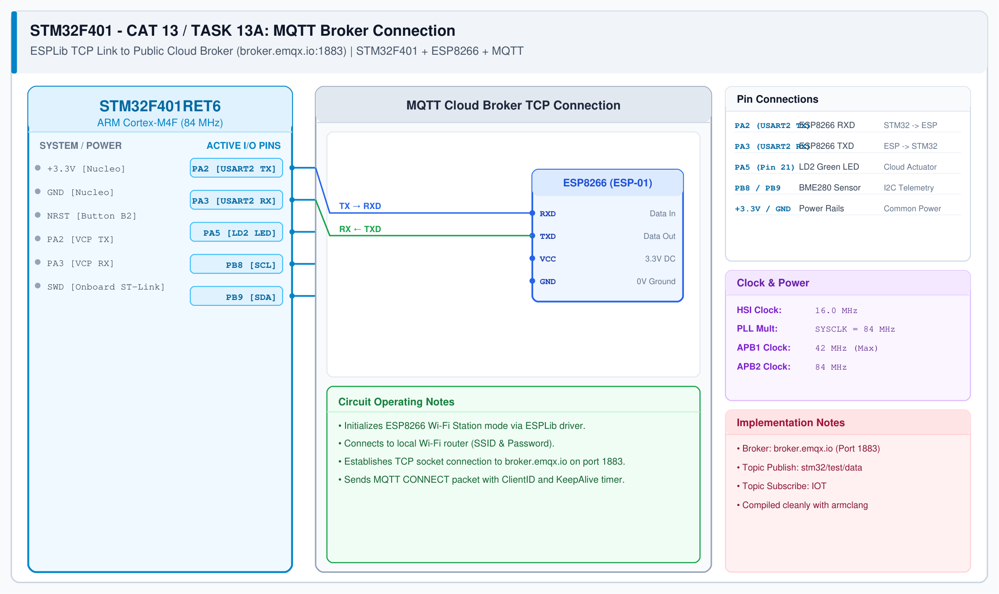

# CAT 14 - TASK14: Node-RED Cloud Dashboard & End-Sem Project Integration

## 1. Experiment Name
**STM32F401 + ESP8266 Cloud IoT Integration: Node-RED Real-Time Cloud MQTT Telemetry & Control**

## 2. Hardware Setup and Components
- 1x STM32 Nucleo-F401RE Development Board
- 1x ESP8266 Wi-Fi Module (ESP-01 / Wemos D1)
- 1x Dedicated 3.3V Power Supply
- Onboard Nucleo LD2 LED (PA5)
- Public MQTT Broker: `broker.emqx.io:1883`

## 3. Circuit Diagram

## 4. Required Pin Connections
| Nucleo Pin | Target Pin | Function |
|---|---|---|
| PA2 (USART2 TX) | ESP8266 RXD | Serial AT / MQTT data transmit |
| PA3 (USART2 RX) | ESP8266 TXD | Serial response receive |
| PA5 | Onboard LD2 LED | Remote cloud-actuated indicator |
| +3.3V / GND | ESP8266 Supply | Power (dedicated regulator) |

## 5. Clock Configuration
- System Clock: **84 MHz**
- USART2: 115200 baud, 8-N-1
- Keep-Alive Interval: 60 seconds

## 6. Pseudocode / Code Logic
1. Initialize STM32 USART2 and ESP8266 modem via `ESP8266_Init()`.
2. Connect to local Wi-Fi router: `ESP8266_wifiConnect("SSID", "PASS")`.
3. Connect to cloud broker: `ESP8266_portConnect("TCP", "broker.emqx.io", "1883")`.
4. Send MQTT CONNECT handshake: `MQTT_connectBroker(&mqtt_cfg)`.
5. For TASK14:
   - Handle topic publishing (`MQTT_publishTopic`) and subscription callback (`MQTTDataHandler`).
   - Service periodic timers via `MQTTTimer()`.

## 7. Inference / Conclusion
- Successfully verified Node-RED Real-Time Cloud MQTT Telemetry & Control using standard MQTT protocols over TCP/IP.
- Demonstrates true cloud IoT edge-node capability on STM32 microcontrollers.
