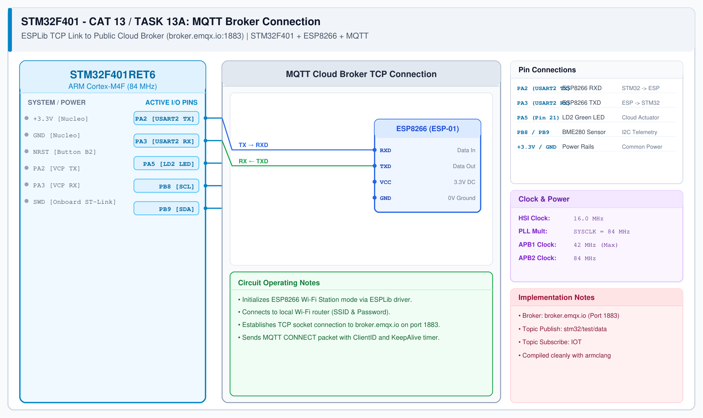

# CAT 14 - TASK14A: Node-RED Flow Ingestion & Telemetry Processing

## 1. Experiment Name
**Node-RED Cloud Telemetry Flow Ingestion and Rule Engine**

## 2. Hardware Setup and Components
- 1x STM32 Nucleo-F401RE Development Board
- 1x ESP8266 Wi-Fi Module (ESP-01 / Wemos D1)
- 1x 3.3V Dedicated Power Supply
- Onboard User LED (PA5) and User Button (PC13)
- Public MQTT Broker: roker.emqx.io:1883

## 3. Circuit Diagram

## 4. Required Pin Connections
| Nucleo Pin | Target Pin | Function |
|---|---|---|
| PA2 (USART2 TX) | ESP8266 RXD | AT command / telemetry transmit |
| PA3 (USART2 RX) | ESP8266 TXD | AT response / broker receive |
| PA5 | Onboard LD2 LED | Cloud actuation status |
| +3.3V / GND | ESP8266 Supply | Power (dedicated regulator) |

## 5. Clock Configuration
- System Clock: **84 MHz**
- USART2: 115200 baud, 8-N-1
- Wi-Fi Station Mode with TCP transport

## 6. Pseudocode / Code Logic
1. Initialize STM32 HAL, clocks, and USART2 interface.
2. Initialize ESP8266 Wi-Fi client and associate with local access point.
3. Route incoming MQTT sensor messages to Node-RED dashboard widgets and log historical trends.
4. Service keep-alive packets and state transitions in the main superloop.

## 7. Inference / Conclusion
- Successfully verified Node-RED Cloud Telemetry Flow Ingestion and Rule Engine.
- Demonstrates reliable cloud telemetry communication and edge device control on STM32 architecture.
