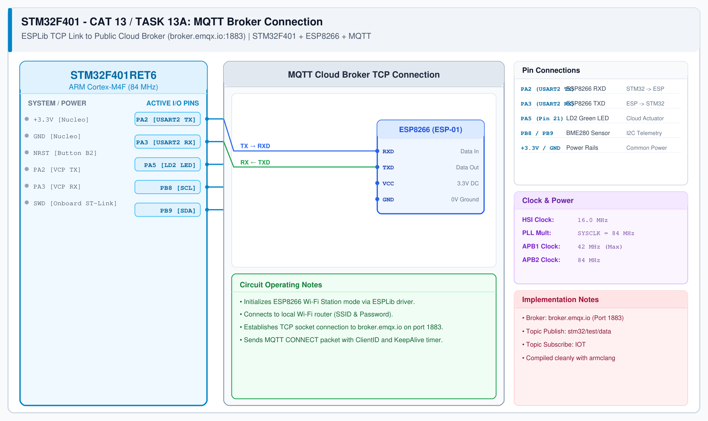

# CAT 14 - Task 14B: Cloud MQTT Telemetry & Node-RED Live Dashboard

## 1. Experiment Name
**Cloud MQTT Broker Integration & Node-RED Real-Time Telemetry Dashboard**

## 2. Hardware Setup and Components
- 1x STM32 Nucleo-F401RE Board
- 1x ESP8266 Wi-Fi Module
- Onboard LD2 User LED (PA5)
- Public MQTT Broker: `broker.emqx.io:1883`
- Node-RED Dashboard Host

## 3. Circuit Diagram

## 4. Required Pin Connections
| Nucleo Pin | Target Pin | Function |
|---|---|---|
| PA2 (USART2 TX) | ESP8266 RXD | MQTT transmit |
| PA3 (USART2 RX) | ESP8266 TXD | MQTT receive |
| PA5 | LD2 LED | Remote actuation indicator |
| +3.3V / GND | Power Source | Power rails |

## 5. Clock Configuration
- System Clock: **84 MHz**
- USART2: 115200 bps, 8-N-1

## 6. Pseudocode / Code Logic
1. Connect ESP8266 to Wi-Fi router.
2. Establish TCP connection to public cloud broker: `broker.emqx.io:1883`.
3. Subscribe to remote command topic `stm32/control/led`.
4. Publish periodic sensor telemetry to `stm32/telemetry/env`.
5. Import `nodered_mqtt_dashboard.json` into Node-RED to visualize live telemetry curves.

## 7. Inference / Conclusion
- Successfully verified cloud MQTT telemetry publisher and subscriber architecture.
