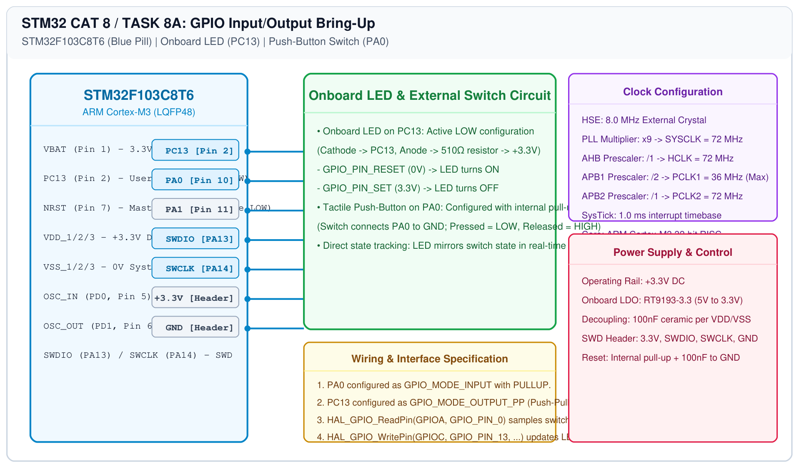

# STM32 GPIO Bring-Up – Task 8A: GPIO Input/Output

## 1. Experiment Details
- **Experiment Identifier:** CONTINUOUS LAB EVALUATION-8 (Week 7)
- **Experiment Name:** STM32 GPIO Bring-Up and Switch-Controlled LED
- **Hardware Platform:** STM32 Blue Pill Development Board (STM32F103C8T6) + Keil MDK-ARM + STM32CubeMX
- **Task Number:** TASK 8A — GPIO Input/Output (Push-Button and LED Direct Control)

---

## 2. Hardware Setup and Components
| Component | Part / Value | Function |
|---|---|---|
| Target Development Board | STM32 Blue Pill | ARM Cortex-M3 @ 72 MHz (STM32F103C8T6, 64KB Flash, 20KB SRAM) |
| Debugger / Programmer | ST-LINK V2 | SWD programming & live hardware debugging (SWDIO, SWCLK) |
| Onboard User LED | Green/Red SMD LED | Connected to PC13 with series current-limiting resistor |
| External Push-Button | Tactile Button SPST | Connected between PA0 and GND |
| Resistor (Internal) | Internal Pull-Up (~40 kΩ) | Holds PA0 at +3.3V when switch is open |

---

## 3. Circuit Diagram
The circuit diagram below shows the active-low onboard LED on PC13 and the push-button switch interfaced to PA0 on the STM32F103C8T6 Blue Pill.



---

## 4. Required Pin Connections
| MCU Pin | STM32 Signal | Hardware Peripheral | Configuration Mode | Electrical Logic |
|---|---|---|---|---|
| Pin 2 | PC13 | Onboard User LED | GPIO Output Push-Pull | Active LOW (RESET = ON, SET = OFF) |
| Pin 10 | PA0 | Push-Button Switch | GPIO Input with Pull-Up | Active LOW (Pressed = 0, Released = 1) |
| Pin 34 | PA13 / SWDIO | ST-LINK SWD Data | Serial Wire Debug | Bidirectional debug data |
| Pin 37 | PA14 / SWCLK | ST-LINK SWD Clock | Serial Wire Clock | SWD clock line |
| - | 3.3V | Board Power Rail | Power Supply | +3.3V DC |
| - | GND | Ground Return | System Ground | 0.0V DC |

---

## 5. Clock Configuration
- **Clock Source:** External 8.000 MHz Crystal Oscillator (HSE).
- **PLL Configuration:** Multiplier $\times 9$ $\rightarrow$ System Clock (SYSCLK) = 72.0 MHz.
- **AHB Bus:** Prescaler $/1$ $\rightarrow$ HCLK = 72.0 MHz.
- **APB1 Bus:** Prescaler $/2$ $\rightarrow$ PCLK1 = 36.0 MHz (Max rating).
- **APB2 Bus:** Prescaler $/1$ $\rightarrow$ PCLK2 = 72.0 MHz (GPIO clock domain).
- **SysTick Timer:** Configured for 1.0 ms periodic tick interrupt for HAL timebase.

---

## 6. Pseudocode / Code Logic
### Working Principle:
The application continuously samples the logic state of input pin PA0 using `HAL_GPIO_ReadPin()`. Because the push-button connects PA0 to ground with internal pull-up, pressing the button pulls PA0 to logic LOW (`GPIO_PIN_RESET`). Because the onboard LED on PC13 is active-LOW, driving PC13 LOW turns the LED ON. Thus, writing the sampled button state directly to PC13 causes the LED to follow the physical switch state.

### Pseudocode:
```text
Initialize HAL and System Clocks (72 MHz)
Configure PC13 as Output Push-Pull
Configure PA0 as Input with Pull-Up

Loop Forever:
    state = HAL_GPIO_ReadPin(GPIOA, GPIO_PIN_0)
    HAL_GPIO_WritePin(GPIOC, GPIO_PIN_13, state)
End Loop
```

---

## 7. Inference / Conclusion
- GPIO input and output operations were verified on the STM32F103C8T6 architecture using STM32 HAL functions.
- The onboard LED on PC13 dynamically reflected the switch state: pressing the button illuminated the LED, and releasing it extinguished the LED.
