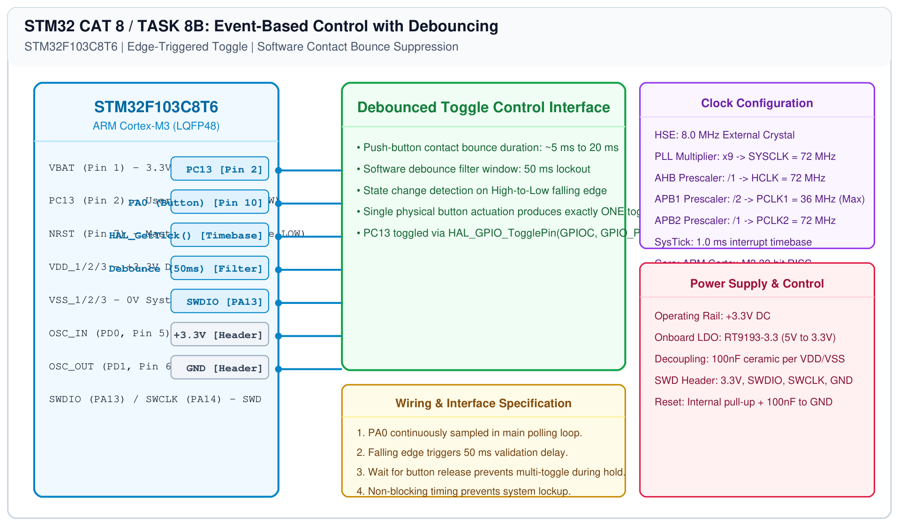

# STM32 GPIO Bring-Up – Task 8B: Event-Based Control with Debouncing

## 1. Experiment Details
- **Experiment Identifier:** CONTINUOUS LAB EVALUATION-8 (Week 7)
- **Experiment Name:** STM32 GPIO Bring-Up and Switch-Controlled LED
- **Hardware Platform:** STM32 Blue Pill (STM32F103C8T6) + Push-Button Switch
- **Task Number:** TASK 8B — Event-Based Toggle Control with Software Contact Debouncing

---

## 2. Hardware Setup and Components
| Component | Function | Description |
|---|---|---|
| STM32F103C8T6 | Microcontroller | 72 MHz ARM Cortex-M3 Blue Pill board |
| Tactile Switch | Input Trigger | Momentary push-button on PA0 |
| User LED | Output State Indicator | Active-LOW LED on PC13 |

---

## 3. Circuit Diagram


---

## 4. Required Pin Connections
| Pin Number | MCU Pin | Peripheral | Configuration |
|---|---|---|---|
| Pin 2 | PC13 | User LED | GPIO Output Push-Pull |
| Pin 10 | PA0 | Push-Button | GPIO Input with Internal Pull-Up |
| Header | GND | Switch Pin 2 | 0V Ground Plane |

---

## 5. Clock Configuration
- **Core Clock:** 72 MHz HSE + PLL.
- **Debounce Timing:** 50 ms lockout window derived from `HAL_GetTick()`.

---

## 6. Pseudocode / Code Logic
### Contact Bounce Mitigation:
Mechanical switches produce noisy transitions lasting 5–20 ms upon contact closure. Without debouncing, a single button press causes the microcontroller to detect dozens of false edges, causing unpredictable LED toggling.

### Algorithm:
```c
uint8_t last_button_state = GPIO_PIN_SET;

while (1) {
    uint8_t current_state = HAL_GPIO_ReadPin(GPIOA, GPIO_PIN_0);
    
    /* Detect falling edge (High to Low transition) */
    if (last_button_state == GPIO_PIN_SET && current_state == GPIO_PIN_RESET) {
        HAL_Delay(50); /* Debounce settling delay */
        if (HAL_GPIO_ReadPin(GPIOA, GPIO_PIN_0) == GPIO_PIN_RESET) {
            HAL_GPIO_TogglePin(GPIOC, GPIO_PIN_13);
            /* Wait until button is released to prevent re-triggering */
            while (HAL_GPIO_ReadPin(GPIOA, GPIO_PIN_0) == GPIO_PIN_RESET);
            HAL_Delay(20); /* Release debounce */
        }
    }
    last_button_state = current_state;
}
```

---

## 7. Inference / Conclusion
- Contact bounce on PA0 was completely eliminated using software edge verification and release lockout.
- Exactly one LED state change was registered per physical button press.
