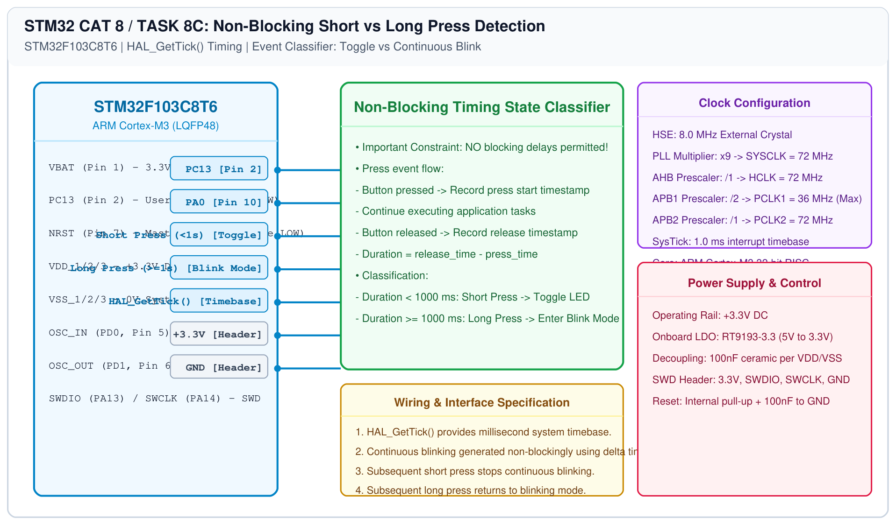

# STM32 GPIO Bring-Up – Task 8C: Short Press vs Long Press Classification

## 1. Experiment Details
- **Experiment Identifier:** CONTINUOUS LAB EVALUATION-8 (Week 7)
- **Experiment Name:** STM32 GPIO Bring-Up and Switch-Controlled LED
- **Hardware Platform:** STM32 Blue Pill (STM32F103C8T6)
- **Task Number:** TASK 8C — Non-Blocking Short Press (< 1s) vs Long Press (>= 1s) Event Detection

---

## 2. Hardware Setup and Components
| Component | Function | Description |
|---|---|---|
| STM32F103C8T6 | System MCU | ARM Cortex-M3 @ 72 MHz |
| Tactile Switch | Input Sensor | Momentary button on PA0 (Internal Pull-Up) |
| User LED | Mode Indicator | Active-LOW LED on PC13 |

---

## 3. Circuit Diagram


---

## 4. Required Pin Connections
| MCU Pin | Signal | Target | Functional Logic |
|---|---|---|---|
| Pin 2 | PC13 | User LED | Active LOW indicator |
| Pin 10 | PA0 | Push-Button Switch | Active LOW input (Pressed = 0, Released = 1) |

---

## 5. Clock Configuration & Operational State Matrix
- **Core Clock:** 72 MHz
- **Timebase:** `HAL_GetTick()` 1 ms millisecond counter.

### System Response Matrix:
| User Action | Duration Threshold | System Response |
|---|---|---|
| Short Press | $\Delta t < 1000\\text{ ms}$ | Toggle LED state immediately |
| Long Press | $\Delta t \ge 1000\\text{ ms}$ | LED enters continuous blinking mode ($\approx 250\\text{ ms}$ rate) |
| Next Short Press | $\Delta t < 1000\\text{ ms}$ | Stop blinking mode (hold current LED state) |
| Next Long Press | $\Delta t \ge 1000\\text{ ms}$ | Return to continuous blinking mode |

---

## 6. Pseudocode / Code Logic
### Non-Blocking Architecture Constraint:
The evaluation document strictly mandates: **"The application must not use a blocking delay to determine whether the button is a long press."**

```c
typedef enum {
    MODE_IDLE_TOGGLE = 0,
    MODE_BLINKING
} SystemMode_t;

SystemMode_t mode = MODE_IDLE_TOGGLE;
uint32_t press_start = 0;
uint8_t is_pressed = 0;
uint32_t last_blink_tick = 0;

while (1) {
    uint32_t now = HAL_GetTick();

    /* 1. Switch State Tracking */
    if (HAL_GPIO_ReadPin(GPIOA, GPIO_PIN_0) == GPIO_PIN_RESET) {
        if (!is_pressed) {
            is_pressed = 1;
            press_start = now; /* Record press start */
        }
    } else {
        if (is_pressed) {
            uint32_t duration = now - press_start;
            is_pressed = 0;

            if (duration >= 50) { /* Filter contact debounce */
                if (duration < 1000) {
                    /* Short Press */
                    if (mode == MODE_BLINKING) {
                        mode = MODE_IDLE_TOGGLE; /* Stop blinking */
                    } else {
                        HAL_GPIO_TogglePin(GPIOC, GPIO_PIN_13);
                    }
                } else {
                    /* Long Press */
                    mode = MODE_BLINKING; /* Enter/return to blink mode */
                }
            }
        }
    }

    /* 2. Non-blocking Blinking Handler */
    if (mode == MODE_BLINKING) {
        if (now - last_blink_tick >= 250) {
            last_blink_tick = now;
            HAL_GPIO_TogglePin(GPIOC, GPIO_PIN_13);
        }
    }
}
```

---

## 7. Inference / Conclusion
- Implemented a fully non-blocking asynchronous event classifier using `HAL_GetTick()`.
- Successfully distinguished between short presses (< 1s) for discrete toggling and long presses (>= 1s) for continuous 4 Hz blinking mode without stalling execution.
